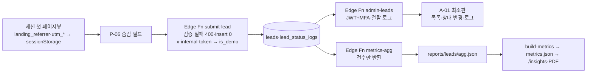

# 제품 정의서 (00-product) — v3

- 버전 v3 · 2026-10-25 · owner `spec-product-lead` · 교차 검토 `spec-tech-lead`·`spec-content-lead` · 판정 `hiring-reviewer`
- 우선순위 2위(README: 95 > **00** > 30·70 > 40 > 50 > 80 > 10 > 20 > 60). 95-legal-ops와 다르면 95를 따른다.
- 입력 미확정: `docs/BENCHMARK.md`(T-090) 없음. 경쟁 비교는 2026-10-25에 직접 연 **콘텐츠 상세(구형·신형)·이벤트 상세·검색 결과 화면 4장**(3-3)만 근거로 쓰고, 나머지 칸은 "T-090 실측 후 확정".
- ID 표기: 이 문서의 KPI는 `KPI-01`~`KPI-13`, 게이트는 `G1`·`G2`, 충돌은 `C1`~, 질문은 `Q1`~. 95의 충돌 ID(K1~K18)와 겹치지 않는다.

## 1. 목적과 범위

리얼성형은 **두 가지 이유로 존재한다**: (1) 실제 리드·수익을 내는 성형 시술 정보·상담 연결 서비스, (2) 성형외과 마케팅·개발 팀 채용 심사용 포트폴리오. 이 문서는 두 목적을 **같은 숫자**로 묶는다. 실리드 0건이면 포트폴리오 숫자도 0건으로 쓴다.

| 이 문서가 결정하는 것 | 이 문서가 결정하지 않는 것 (원본) |
| --- | --- |
| 서비스 한 줄 정의·범위·색인 대상 URL 산식 (3-1) | 화면별 구성·이벤트 (screen-spec, docs/layouts/*) |
| 이용자 페르소나 2명 + 심사자 페르소나 2명 (3-2) | 디자인 토큰·컴포넌트 (10-design) |
| 경쟁 비교 대상 화면과 차별점 7개 (3-3) | 경쟁사 실측 전수 (BENCHMARK, T-090) |
| KPI 13개 + 게이트 2개: 목표·하한·측정 방법·원천·값 스키마 (3-4) | 이벤트 스키마·전환 구현 (40-tracking) |
| 리드 데이터 흐름과 집계 경로 (3-5) | 컬럼 타입·암호화 (30-data), Edge Function 구현 (70) |
| 수익 모델 3개의 순서·시작 조건·표기 (3-6) | 금지 표현·동의·보존 규칙 본문 (95-legal-ops) |
| 법적 경계 요약 링크 + 95 갱신 전 기본값 (3-7) | 제출물 D1~D8 양식 (90-deliverables) |
| 콘텐츠 계획: 완본 조건·AEO 질문 20개·네이버 키워드 20개·가격 조사 (3-8) | 문장 톤·각주 형식 (20-content) |
| 마일스톤 M0~M4 날짜, 느린 신호 16개, 지연 규칙 (3-9) | 광고 캠페인 세부·예산 배분 (60-growth) |
| T-080 후속 결정 3건 (3-10) | — |

**범위 밖 (M4 2026-12-21까지 0개)**: 다국어 페이지, 앱, 이용자 회원가입·로그인, 결제·판매 중개, 후기·평점, 카카오톡 상담(T-006 결정 전), P-02·P-04·P-08·P-09·P-10·P-11·A-02·A-03. 네이버 블로그 4편의 원문 링크는 P-03 가이드로 건다(P-10 불필요).

### 가정 (무인 모드, 2026-10-25)
- 가정: 첫 카테고리 = 눈(T-002 기본값). 시드 10개 중 눈은 4개(쌍꺼풀 수술·앞트임·눈매교정·눈밑지방재배치), 나머지 6개는 코 1·윤곽 2·리프팅 1·피부 1·가슴 1.
- 가정: 도메인(T-000, 승인됨)은 2026-11-01까지 연결된다. 늦어지면 3-9-3.
- 가정: T-500(광고비 266,700원) 판정 시각 2026-11-09 23:59(90 3-7-5).
- 가정: 제휴 병원 0곳 상태로 M4까지 간다. 리드는 운영자가 응대하고 병원 전달 0건(95 3-5).
- 가정: 가상 병원 3곳(`data/seed/clinics.json`, 전부 `is_demo = true`)은 화면 시연용이며 색인 대상이 아니다.

## 2. 원칙

1. **숫자 1개 = 두 목적**: 실리드 수·CPL·색인 수·AI 인용률·전환 대조율은 수익·운영 지표이면서 D8 커버 숫자다. 자기 판정(채용 여부)·체크 개수는 KPI가 아니라 게이트(3-4 D). 예: KPI-01 실리드 12건 → `/insights#funnel`·D4·D8에 같은 값 12.
2. **느린 신호 먼저**: 결과까지 7일 이상 걸리는 신호(색인 2~4주, AI 답변 출처 반영, 광고 학습 1~3주, AEO 4주 연속 측정)는 화면 작업보다 먼저 시작한다. 시작 기한 = 결과 필요일 − 최대 소요일. 예: KPI-06 판정일 2026-12-08 − 색인 최대 28일 = 도메인 속성 사이트맵 제출 한도 2026-11-10. AEO는 측정 시작일(11-10)보다 **측정 대상 가이드 배포(11-03)가 먼저**다.
3. **95 경계 안에서만 번다**: 리드·예약 건당 수수료 0원, 우리 광고·콘텐츠에 병원명·의사명 유인 0개, 평점 0개.
4. **측정할 수 없는 목표는 쓰지 않는다**: 표본이 5건 미만으로 설계되는 비율 지표는 D8에 넣지 않고, 외부 근거 없는 목표 CPL은 사전에 정하지 않는다(3-4 KPI-02·03).
5. **실측이 아니면 표시한다**: 미달은 "미달 + 실측값", 표본 부족은 "표본 부족", 가격 조사 전은 가격 칸 "예시 가격" 라벨 + FAQ 가격 답변·3줄 요약·JSON-LD에 금액 0개("병원 공개 가격 조사 중(기한 YYYY-MM-DD)"), 경쟁 수치는 "T-090 실측 후 확정". 지어낸 숫자 0개(시드 `view_count` 포함, 3-8-4).

## 3. 규칙

### 3-1 서비스 정의·범위·색인 대상

| 항목 | 정의 | 확인 위치 |
| --- | --- | --- |
| 한 줄 정의 (≤ 70자) | "성형 시술 가격 범위·회복기간을 출처·조사일과 함께 비교하고, 가입 없이 2단계로 상담 가이드를 받는다." | P-01 히어로 H1 아래 1문장. 문자열 `가입 없이 2단계`가 `out/index.html`에 1회 이상 |
| 법적 성격 | 의료기관·의료인이 아닌 시술 정보·가격 범위 비교·상담 연결 서비스 | 95 1절·3-11 |
| 상호 표기 | "리얼성형" 4글자 전체로만 쓴다. "리얼" 단독, "리얼 + 후기·사례·경험·전후" 조합 0개(95 B06 취지) | 화면·광고 소재 |
| 화면 | P0 8개: P-01·P-03·P-05·P-06·P-07·P-12·A-01·C-01 + `/insights`(D7) | screen-spec 2절 |
| 시술 | 시드 10개 전부 페이지 생성. **완본**(3-8-1 F1~F5·F7·F8 통과, 가격 조사 F6은 라벨만 좌우)만 색인. 미완본은 `noindex` + sitemap 제외 + 첫 화면 "가이드 작성 중 · 가격은 예시 가격" 1줄 | `/procedures/{slug}` 소스의 robots 메타 |
| 완본 일정 | 눈 4편 2026-11-03(3-9 S13) → 나머지 6편 2026-11-17(완본 조건 통과분만 색인 전환) | sitemap 시술 하위 URL 수 |
| 병원 | 가상 3곳: `noindex` + sitemap 제외 + MedicalClinic JSON-LD 0 + "예시 데이터" 뱃지. 공개 정보 병원(T-306 [human-gate] 승인 후 최대 10곳)만 색인 | P-05 소스 |
| 가상 병원 상담 동선 | 가상 병원 P-05의 상담 CTA는 병원 지정 없이 시술 기준으로만 연결: 버튼 문구 "이 시술 상담 가이드 받기", 링크 `/consult?procedure={id}`(clinic_id 0), 버튼 바로 위 고지 1줄 "예시 병원입니다 — 실제 병원이 아니며 이 병원으로 상담이 연결되지 않습니다". M1 흐름(병원 상세 → 상담)은 유지 | P-05 375×812 |
| `/insights`·`/deliverables/` | `noindex`, sitemap 제외, 이용자 화면(P-01·P-03·P-05·P-06·P-07·P-12·푸터)에서 링크 0개. `/insights` 상단 고정 문구 "운영 지표(채용 심사용) — 시술·병원 선택 기준이 아닙니다" | 소스·링크 검사 |
| 상담 | P-06 2단계, 필수 입력 6개(시술·희망 지역·희망 시기·이름·연락처·연락 가능 시간) + 선택 1개(메모), 동의 체크박스 3~4개(95 3-6), 가입 0회 | P-06 |
| 상담 가이드(응대 범위) | 운영자 1차 연락에서 하는 일 3개: 접수 확인, 본인 확인, 시술별 안내 문자 1건 발송(확인 질문 5개 + P-03 가격 범위·출처 + 공개 정보 병원 목록 이름순). 하지 않는 일 4개: 진단, 시술 권유, 특정 병원 추천, 가격 협상. 문자 원고는 20-content가 시술별로 작성 | A-01 상태 로그, `docs/content/consult-guide-*.md` |

**sitemap URL 수 산식** = 1(`/`) + 완본 P-03 수 + 2(`/privacy`·`/terms`) + 공개 정보 병원 수(`is_demo = false`). 예상: M1 11-09 = 1 + 4 + 2 + 0 = 7, M2 11-23 = 1 + 10 + 2 + 0 = 13(6편 전부 완본 시), T-306 10곳 등록 시 23.

### 3-2 타겟 페르소나

**이용자 페르소나 (수익 목적)** — 예시 페르소나, 수치는 설계용 가정.
| ID | 프로필 | 유입 경로 | 할 일(Job) | 성공 기준 (측정 방법) | 막히는 지점 → 우리 대응 |
| --- | --- | --- | --- | --- | --- |
| U1 | 27세 여성, 서울 마포 직장인, 쌍꺼풀 수술 검토, 예산 100만~200만 원, 휴가 5일 | 네이버 검색 "쌍꺼풀 수술 회복기간" 또는 메타 광고 → P-12 | 가격 범위·회복기간 확인 → 상담 1회 | (a) P-03 첫 화면(375×812)에 가격 범위·회복기간 2개 값 — e2e 단언 (b) **Job 전체 구간** view_procedure → generate_lead 같은 세션 소요 시간 중앙값 ≤ 300초(잠정) (c) **폼 구간** form_start → generate_lead 같은 세션 중앙값 ≤ 90초. (b)·(c) 둘 다 GA4 이벤트 시각 차, 측정 방법은 40-tracking이 확정 | 앱 이벤트가 할인가 위주, 상세 가격은 로그인 뒤(3-3 관찰) → 로그인 0회로 가격 범위 + 조사일 + 출처 |
| U2 | 32세 여성, 경기 성남, 눈밑지방재배치 검토, 부작용 우선 확인 | ChatGPT·Perplexity 질문 → 답변 출처 링크 | 부작용·회복 정보 출처 확인 | AEO 질문 16~20(3-8-2)에서 우리 URL 인용 ≥ 1건 — `aeo_checks.csv`. 외부 통제 지표라 KPI-08로만 판정 | 설문·후기 근거(O1) 또는 문서당 각주 3개(O1b) → 숫자 문장 100% 각주 + DOI·PMID + FAQ 5~8 |

- U1·U2의 시술(쌍꺼풀 수술·눈밑지방재배치)은 11-03 완본 4편에 포함된다.
- 범위 밖: 의료관광(일본·중국·동남아) 수요 — 다국어 0개(M4까지).

**심사자 페르소나 (채용 목적)** — 행동 순서 90 1절: 커버 30초 → 상세 1건 3분 → 배포 URL 클릭.
| ID | 프로필 | 매일 쓰는 것 | 이 사람이 세는 것 | 채용 신호 (숫자) | 실망 신호 |
| --- | --- | --- | --- | --- | --- |
| H1 | 성형외과 마케팅 팀장. 검색광고·메타 광고 직접 집행, 의료광고 심의 경험 | 강남언니·바비톡 병원 계정, 네이버 검색광고·메타 광고 관리자, GA4 | CPL, 리드 장부와 플랫폼 수치 차이, 검색어 유지/제외 판정 수, 소재 심사 칸 수, 학습 제한 대응 | D5·D6 지표 12개 + 리드 합계 = 집계 장부 ±0, 검색어 판정 ≥ 20행, 소재 100칸 전부 O, 메타 제한 분기 기록 | 플랫폼 보고 리드만 있고 장부 대조 0, 효과 보장 문구 1건 |
| H2 | 성형외과 개발 팀장. 병원 홈페이지·랜딩·트래킹 개발 | 사내 랜딩 코드, GTM, 서치콘솔 | e2e 통과 수, Lighthouse 점수, 이벤트 수신 수, JSON-LD 오류 수, 개인정보 저장 방식 | e2e 375·1280 2/2, Lighthouse 모바일 P-03 Perf ≥ 90·SEO 100, 이벤트 수신 n/21, validator 오류 0, 행 단위 리드 데이터가 저장소에 0행 | 깨진 링크 1개, 콘솔 error 1개, 태그 하드코딩, 가상 병원이 색인됨 |

- H1은 수익 모델 RM2(병원 프리미엄 노출)의 **구매자 페르소나와 같은 사람**이다.

### 3-3 가치 제안 — 경쟁 비교 대상 화면과 차별점 7개

**비교 대상 화면 (고정)**: 홈 화면은 비교에 쓰지 않는다. 경쟁사 형식이 2개 이상이면 **가장 최근 형식(가장 강한 쪽)**을 기준으로 비교한다. 아래 4화면만 쓴다.
| 코드 | 화면 | URL | 관찰 (2026-10-25, WebFetch 렌더 텍스트) |
| --- | --- | --- | --- |
| O1b | 강남언니 콘텐츠 상세 — **신형, 비교 기준** | `https://unni.app/contents/3f9d9338-d3d4-80da-916a-f41425fe332d` ("쥬베룩볼륨·레디어스 결절 부작용…", 업데이트 2026.10.23) | 본문 로그인 없이 열람, 문장 부착 각주 3개(¹²³) + 문서 끝 "인용한 자료" 3건(Aesthetic Surgery Journal·Cureus·J Cranio-Maxillo-Facial Surgery, Europe PMC 링크, DOI 표기 0), FAQ 2개, 시술 가격 0개, 작성자·의료 검토 표기 0, 앱 설치 쿠폰 배너 + 앱 상담 예약 유도 1문장 |
| O1 | 강남언니 콘텐츠 상세 — 구형(참고) | `https://unni.app/contents/23bd9338-d3d4-803d-af5b-da1273ec67d1` ("쌍꺼풀수술 붓기 어느정도? 쌍꺼풀수술 회복기간은?") | "업데이트: 2026.07.06", 학술 각주 0개, FAQ 0개, 근거 = 경험자 100명 설문·후기 발췌. 구형·신형이 공존하므로 차별점 판정에는 쓰지 않음 |
| O2 | 강남언니 이벤트(시술 상품) 상세 | `https://unni.app/events/85230` | 가격 1,100,000원 등 표기, 가격 출처·조사일 0, 평점 "9.5(490)", 후기 로그인 필요, 앱 설치 쿠폰 배너 |
| O3 | 바비톡 키워드 검색 | `https://www.babitalk.com/search?keyword=쌍꺼풀` | 공개 가격 0(견적은 로그인 뒤), 후기 로그인 필요("로그인 및 회원가입 하기"), 앱 설치 QR, FAQ 0, 갱신일 0, 출처 0 |

- WebFetch 렌더 텍스트는 접힌 영역·이미지 속 글자를 놓칠 수 있다. T-090이 같은 4 URL + 업데이트일이 가장 최근인 강남언니 콘텐츠 상세 2건 추가를 375px 스크린샷·소스로 다시 관찰해 이 표와 아래 "잠정" 칸을 확정한다. 더 최근 형식이 발견되면 그 화면이 비교 기준(O1b)을 대체한다. 확정 전 이 표의 관찰을 화면·광고 문구에 인용 0회.

| # | 차별점 | 경쟁 관찰 (O1b·O2·O3, 잠정) | 리얼성형 목표 (숫자) | 확인 위치 |
| --- | --- | --- | --- | --- |
| V1 | 로그인·앱 설치 없이 가격 범위 확인 (1순위) | O2 후기 로그인, O3 가격·후기 로그인, O1b·O2·O3 앱 설치 유도 1개씩, O1b 시술 가격 0 | 로그인 요구 0회, 앱 설치 유도 0개, P-03 첫 화면에 가격 범위 1개 | P-03 375×812 |
| V2 | 가격 출처·조사일 | O2 가격 있음·출처 0·조사일 0, O3 공개 가격 0 | 가격 표시 100%에 조사일 YYYY-MM-DD + 병원 공개 가격 n곳(n ≥ 5, 미달·만료 시 "예시 가격" 라벨), 조사일 ≤ 30일 전 | P-03 가격 분포 바 아래 |
| V3 | 의학 출처 범위 | O1b 문서당 각주 3개(문장 부착, 논문 3편). 각주 없는 숫자 문장 수는 T-090에서 셈 | 숫자+단위 문장 **100%** 각주(누락 1건 = 빌드 실패, 3-8-1 F1), 출처 서로 다른 기관 ≥ 3, URL은 페이지 단위 또는 DOI·PMID, 루트 도메인 URL 0개, 의료 검토 상태 표기 1줄(95 3-8) — O1b는 의료 검토 표기 0 | P-03 각주·메타 줄 |
| V4 | 3줄 요약 + FAQ 3중 일치 | O1b FAQ 2개·요약 박스 0, O3 FAQ 0. O1b의 FAQPage JSON-LD 유무는 T-090 소스 확인 | P-03 첫 화면 "3줄 요약"(문장 3개, 문장당 40~60자, 복사 버튼) = `MedicalWebPage.abstract` = FAQ 1번 답변, FAQ 5~8개 + FAQPage JSON-LD | P-03 상단·FAQ |
| V5 | 평점 대신 신뢰 요소 | O2 평점 "9.5(490)" | 평점·별점 0개, 90 3-10 신뢰 요소 5개 | P-03·P-05 |
| V6 | 상담 신청 마찰 | O3 견적 로그인 필요 | 가입 0회, P-03 CTA → 제출 클릭 ≤ 5회(화면 전환 3 + 필수 동의 체크 2, 전체 동의 사용 시 4), 사전 체크 0 | P-06 |
| V7 | 구조화 데이터 공개 | T-090 실측 후 확정 | 전 페이지 하단 토글 1클릭으로 JSON-LD 원문 + 리치 결과 테스트 링크 | 전 페이지 하단 |

- v1의 "페이지 갱신일" 차별점은 O1·O1b에 업데이트일이 있어 삭제했다. 우리 갱신일 규칙은 3-8-1(날짜만 바꾸기 금지)로 남긴다.
- 첫 화면 속도 목표: Lighthouse 모바일 LCP ≤ 2.0초(QUALITY 4절). O1·O3 LCP는 T-090 실측 후 추가.
- **타사명 규칙(기본값, 95 갱신 전)**: 이용자 화면(`out/` 중 `out/insights/**`·`out/deliverables/**` 제외)과 광고 소재에 강남언니·바비톡·여신티켓 이름 0회. `/insights#aeo`와 D3·D8은 타사명 + 측정값 + 관찰일·측정 조건 링크만 쓰고 평가어("낫다·부족·뒤처진" 등) 0개. D8 경쟁 표의 단일 원본은 이 3-3(7행). 95 B07은 "타 병원"만 다루므로 플랫폼 비교 규칙을 95에 넣는 것은 Q9.

### 3-4 KPI (13개) + 게이트 (2개)

**공통 규칙**
- 집계: 매주 월요일 10:00 KST(GitHub Actions cron `0 1 * * 1`, UTC) → Edge Function `metrics-agg` → `scripts/build-metrics.mjs` → 빌드 → 배포. 구현은 70-engineering, 담당 builder(T-141). 기간 = 직전 월~일.
- 숫자 표기·표본 부족·마스킹은 90 3-5. 공개 화면 리드 1~4건 칸은 "5건 미만"(95 3-6).
- 값 저장: `reports/metrics.json`의 `kpi["KPI-01"]`~`kpi["KPI-13"]`. 하위 지표가 있는 KPI는 `kpi["KPI-05"].sub.sla` 형식. 값 스키마(zod 검증, 실패 시 빌드 실패):
```
{ value: number | null, unit: "건" | "원" | "%" | "개" | "점",
  status: "ok" | "below" | "insufficient" | "na" | "needs-key",
  period: "YYYY-MM-DD~YYYY-MM-DD", source: string, captured_at: "YYYY-MM-DD" }
```
  mock 모드 값은 `value: null, status: "needs-key"`. 화면·PDF는 status를 "미달"·"표본 부족"·"해당 없음"·"키 대기"로 표기.
- 내부·심사용 리드 제외: Edge Function `submit-lead`가 비밀 헤더 `x-internal-token`(GitHub Secrets·Edge env 보관)을 검증한 요청만 `is_demo = true`로 저장. is_demo 리드는 Resend 알림 0, CAPI 0, P-07 generate_lead push 0, 모든 KPI 제외. `utm_source=internal`만으로는 is_demo 처리 0(누구나 붙일 수 있음). 95 3-7과 다름 → C17·Q10.

**A. 수익·운영 KPI**
| ID | KPI | 정의·계산 | 목표 (M4 누적) | 하한·분기 | 원천 | 담당 | 제출물 |
| --- | --- | --- | --- | --- | --- | --- | --- |
| KPI-01 | 실리드 수 (북극성) | leads 행 수, is_demo = false, 기간 내 created_at | 11건 = 메타 5(90 D6 하한) + 네이버 검색광고 3(추정) + 오가닉 3(잠정). 채널별 몫은 리드 수 목표이며 CPL 목표 아님 | 10건(90 D4). 메타 Lead 최적화 제한 분기면 메타 몫을 KPI-03 분기 행으로 판정 | `metrics-agg` → `reports/leads/agg.json`(건수만) | tracker | D4, D7, D8 |
| KPI-02 | 검색광고 운영 | (a) 검색어 보고서 유지/제외 판정 행 수 (b) CTR (c) CPC (d) 검색 CPL = 비용 ÷ agg.json `by_source.naver_ads` | (a) ≥ 20행 (b)·(c) 실측 기록 (d) 리드 ≥ 5일 때만 값 | (d)는 예산 98,700원 ÷ CPC 1,000원 × 랜딩 전환율 3%(잠정) ≈ 3건으로 **설계상 표본 부족** → D8에는 (a)·(b)만, (d)는 D5에만 | 네이버 검색광고 CSV + agg.json | ads-analyst | D5, D8(a·b) |
| KPI-03 | 메타 운영 | (a) **메타 CPL = flight 21일 누적 1개 값**(11-10~11-30 비용 ÷ leads utm_source=meta). 주간·R1·R2별 CPL은 산출 0 (b) R1·R2 비교 지표 3개: CTR, CPC, 랜딩 조회당 비용(비용 ÷ view_lp 세션) | (a) 목표 CPL 없음(외부 근거 미확보, 아래) — 리드 ≥ 5(90 D6) 충족 여부만 판정 (b) R2가 R1보다 3개 중 2개 이상 개선이면 "개선" 기록(목표 아님, D6 인사이트용) | (a) 21일 누적 리드 < 5면 "표본 부족". **제한 분기**: 95 3-4 R5로 최적화 목표가 랜딩 페이지 조회로 바뀌면 (a) 대신 랜딩 조회당 비용 21일 누적 + 리드 수 병기, D6에 "Lead 최적화 제한" 1줄 | 메타 광고 관리자 CSV + GA4 + agg.json | ads-analyst | D6, D8(a) |
| KPI-04 | 상담 폼 완료율 | GA4 Data API `runReport` eventCount(generate_lead) ÷ eventCount(form_start), 기간 동일. 모수 = 분석 동의 사용자 | ≥ 30% (잠정, 60-growth 확정) | < 20%면 P-06 개선 작업 1건. 키 없음 = needs-key | GA4 Data API(T-205) | tracker | D4, D7 |
| KPI-05 | 응대 품질 | (a) SLA 준수율 = 다음 영업일 18:00 안 1차 연락 ÷ 리드 (b) 유효 리드율(90 3-6 #10) | (a) 100% (b) ≥ 70% (잠정) | (a) < 100% 주는 TASKS `ops` 1건(95 3-5) | lead_status_logs(A-01 최소판, M1) | 사람 + tracker | D5·D6 #10·#11 |
| KPI-10 | 제휴 링크 클릭률 | click_affiliate ÷ view_procedure | ≥ 2.0% (잠정) + 쿠팡파트너스 리포트 금액(원) 실측 | `affiliate_items.json` 행 0 → "해당 없음 — 영역 숨김" | GA4 Data API + 리포트 캡처 | tracker | D7 |
| KPI-11 | 병원 섭외 회신 수 | T-306 섭외 메일(사람 승인 후 발송) 중 회신 | ≥ 1곳 | KPI-01 < 10이면 "발송 전" | `reports/ops/outreach.csv`(병원명·발송일·회신일, 개인 연락처 0) | 사람 | D8 소개 |
| KPI-12 | 전환 대조율 | GA4 generate_lead ÷ leads 행 수(is_demo 제외) | ≥ 50% 그리고 초과 0(GA4 > leads인 주 0) | < 50% → 원인 조사 작업 1건(90 D4) | GA4 Data API + agg.json | tracker | D4, D8 |

- KPI-01 산식: 메타 5 = 90 D6 통과 하한 그대로(비용 ÷ 리드 산식으로 만든 숫자 아님), 네이버 3 = KPI-02 (d) 클릭·전환율 추정, 오가닉 3(잠정). 합계 11은 하한 10과 1건 차이 — 근거 없는 상향 목표를 두지 않기 위함. T-500 미승인이면 목표 = 오가닉 3건, 하한 10건 유지 + 미달 표기.
- KPI-03 외부 근거: 2026-10-25 웹 검색(대행사 AMPM 인사이트 등)에서 성형외과 메타 업종 평균 CPL 수치 미확보. 따라서 사전·중간 목표 CPL 모두 0개. R1(7일) 리드는 약 3건 이하로 예상되어 R1 CPL로 기준선을 만들지 않는다. 60-growth가 출처 있는 수치를 찾으면 그때 목표를 추가한다.
- 검색 CPL을 측정 가능한 표본(리드 ≥ 5)으로 만드는 예산 증액은 비용 항목이라 결정하지 않는다 → Q11(needs-approval 후보).
- GA4 `value`(screen-spec 5절 50,000원)는 입찰·비교용 가중치다. 화면·PDF에서 "매출"·"수익"으로 합산 표기 0회.

**B. 포트폴리오(검색·트래킹) KPI**
| ID | KPI | 정의·계산 | 목표 | 하한 | 원천 | 담당 | 제출물 |
| --- | --- | --- | --- | --- | --- | --- | --- |
| KPI-06 | 구글 검색 노출 | (a) 서치콘솔 **도메인 속성** "페이지 색인 생성" 색인됨 수 ÷ sitemap URL 수(3-1 산식) (b) 같은 속성 실적 보고서 노출 수·클릭 수, 2026-11-10~12-07 4주 합계. 경과일 기준 = 도메인 속성 사이트맵 제출일 | 판정일 2026-12-08: (a) ≥ 60% (b) 실측 기록(목표 없음, 분모 7~23인 색인률만으로는 SEO 증거가 얇아 병기) | (a) < 60% = 미달. (b) 노출 0이면 "노출 0". github.io 속성 값은 집계 0 | 서치콘솔 캡처 + CSV | seo-auditor | D2, D8(a·b 한 칸) |
| KPI-07 | 네이버 수집 | 서치어드바이저 수집 요청 수·수집 수 | 요청 ≥ 10(sitemap URL 수가 10 미만이면 전부), 수집 ≥ 5 | 도메인 연결일 > 11-10 또는 미연결 = "해당 없음 — T-000 미완" | 서치어드바이저 캡처 | seo-auditor | D2 |
| KPI-08 | AEO 우리 인용률 | 90 3-8-2: 1의 수 ÷ (80 − NA), 4주 320행, 질문 20개 = 3-8-2 표 | 4주 누적 우리 인용 ≥ 1건, 4주차 주간 ≥ 2.5%(2/80) | 0건 → "0% (유효 n칸 중 0)" + 경쟁 2사 인용률 | `reports/aeo/aeo_checks.csv` | 사람(입력) + seo-auditor | D3, D8 |
| KPI-09 | 검색 순위 진입 | 3-8-3 키워드 20개 중 구글 평균 게재순위 ≤ 10 수, 네이버 수기 순위 ≤ 30 수 | 구글 ≥ 2, 네이버 ≥ 2 (잠정) | 0개 → 미달 + 노출 0 키워드 수 | `rank.csv`, `naver-rank.csv` | seo-auditor | D2 |
| KPI-13 | 트래킹·구조화 데이터 건전성 | (a) 이벤트 수신 수 n/21(T-205, "해당 없음" 제외) (b) validator.schema.org 오류 수(P-03 4종 + 색인 대상 P-05) (c) GTM 컨테이너 버전·태그 수·Preview 캡처 | (a) P0 9개 전부 수신 (b) 0 (c) 버전 번호·태그 수 기록 + Preview 캡처 1장 | 키 없음 = needs-key + DebugView 캡처 | GA4 Data API, validator 결과 JSON, GTM 컨테이너 export·Preview 캡처 | tracker, seo-auditor | D4(a·c), D2(b) |

**C. D8 숫자 칸 6개 × 3요소(값·출처·기간+캡처일) = 18칸 (90 3-9와 칸 수 같음, 칸 내용 다름 → C18·Q12)**
| 칸 | KPI | 칸에 쓰는 값 | 표기 예 |
| --- | --- | --- | --- |
| 1 | KPI-01 | 실리드 수 | "실리드 12건 (leads 집계, 11-10~12-07, 캡처 12-08)" |
| 2 | KPI-03 (a) | 메타 CPL 21일 누적 1개(제한 분기면 랜딩 조회당 비용) | "메타 CPL 표본 부족 (리드 5건 미만, 비용 168,000원)" — 1~4건은 숫자 대신 "5건 미만"(95 3-6) |
| 3 | KPI-02 (a)+(b) | 검색어 판정 행 수 · CTR (한 칸, 출처 동일) | "검색어 판정 23행 · CTR 2.4%" |
| 4 | KPI-06 (a)+(b) | 색인률 · 노출·클릭 4주 합계 (한 칸, 출처 동일) | "색인 9/13 = 69.2% · 노출 1,240 · 클릭 31" |
| 5 | KPI-08 | AEO 우리 인용률 | "0.9% (유효 314칸 중 3)" |
| 6 | KPI-12 | 전환 대조율 | "GA4 ÷ leads = 66.7% (8/12)" |

- 네이버 수집(KPI-07)은 도메인 의존이라 D2에만 둔다. 표기 예의 숫자는 형식 예시이며 목표가 아니다.
```
KPI-01 실리드 ─┬─ KPI-02 검색광고 운영 ── D5
               ├─ KPI-03 메타 운영 ─────── D6
               ├─ KPI-04 폼 완료율 ─┐
               └─ KPI-12 전환 대조율 ┴─ D4 (+ KPI-13a)
KPI-06·07·09 + KPI-13b ── D2
KPI-08 ── D3
KPI-10·11 ── RM1·RM2 매출 선행 지표
D8 6칸 = KPI-01 · 03a · 02ab · 06ab · 08 · 12
```

**D. 게이트 (KPI 아님, D8 숫자에 넣지 않음)**
| ID | 게이트 | 기준 | 시점 | 기록 |
| --- | --- | --- | --- | --- |
| G1 | 공고 요건 증명 | 90 3-1 R0~R7 중 "완" 8/8. 6/8 미만이면 M4 제출 보류 | M2·M3·M4 | D8 요건 매핑표 |
| G2 | 채용 판정 | hiring-reviewer "채용하겠다 = 예". M3·M4 = 예 필수. 아니오면 사유 3개 → 수정 작업 | M1·M2·M3·M4 (각 ±2일) | `backlog/log/<date>-hire-review.md` |

### 3-5 리드 데이터 흐름



| 단계 | 저장·전달 키 | 규칙 |
| --- | --- | --- |
| 유입 기록 | sessionStorage `rs_landing_referrer`, `rs_utm`(utm_source·medium·campaign·content), `rs_landing_page` | 세션 첫 페이지뷰에서 1회 기록. P-06 시점의 `document.referrer`는 자사 URL이라 쓰지 않는다 |
| 네이버 오가닉 판정 | landing_referrer 호스트 | `search.naver.com`·`m.search.naver.com` = `naver_organic`. `blog.naver.com`·`m.blog.naver.com` = `referral`(블로그) |
| 형식 검증 | submit-lead | 형식 오류는 400 응답·insert 0 → KPI-01에 "형식 오류 제외" 단계 없음 |
| 집계 | `metrics-agg` 응답 `{period, by_source:{naver_ads, meta, ai_referral, naver_organic, google_organic, other_organic, referral, direct}, total, is_demo_excluded}`(키 8개). 분류 순서(고정, 위에서 먼저 걸린 키 1개): ① utm_source=naver·utm_medium=cpc → naver_ads ② utm_source=meta → meta ③ landing_referrer 호스트 chatgpt.com·perplexity.ai·gemini.google.com·copilot.microsoft.com → ai_referral ④ search.naver.com·m.search.naver.com → naver_organic ⑤ www.google.*·google.* 검색 → google_organic ⑥ bing.com·search.daum.net → other_organic ⑦ 그 밖의 외부 호스트(blog.naver.com 포함) → referral ⑧ referrer 없음 → direct | 행 단위 리드(이름·전화·메모)는 저장소에 0행. `reports/leads/*.csv`는 `.gitignore`. 90 3-4의 `leads.csv` 대조는 agg.json으로 대체(C19) |
| 운영 기록 | `reports/ops/milestones.json` `{domain_connected_at, gsc_domain_sitemap_at, naver_registered_at, m0_passed_at, m1_passed_at, t500_decision, flight_start, flight_end}` | 3-9-3 지연 규칙·3-10 결정 1의 판정 입력. 사람 또는 오케스트레이터가 기록 |

### 3-6 수익 모델 (95 경계 안, 시작이 빠른 순서)

| 순서 | ID | 모델 | 방식 | 시작 조건 | M4까지 목표 | 95 근거 |
| --- | --- | --- | --- | --- | --- | --- |
| 1 | RM1 | 제휴 링크(쿠팡파트너스) | P-03 하단 "회복기 관리 용품(광고)" 영역, 최대 3개 텍스트 링크. 문구 = 제조사 표기 사실(제품명·용량)만, 효능·"추천" 0개, 영역마다 "광고" 라벨 1개 + 수수료 고지 1문장 | `data/seed/affiliate_items.json` 행 ≥ 1(T-001 선택 항목). 0행이면 영역 0개 | KPI-10 | 3-13 제휴 링크 행 |
| 2 | RM2 | 병원 프리미엄 노출 | 월 정액, 목록 상단 고정 + "광고" 라벨 + 심의번호. 리드·예약·내원 수 연동 요금 0원 | KPI-01 ≥ 10 + T-306 공개 정보 병원 등록 + T-018 변호사 검토 승인 | 계약 0건 예상, KPI-11 ≥ 1 | 원칙 1, 3-9, 3-11 |
| 3 | RM3 | 시술 트렌드 리포트(B2B) | 시술별 검색량·리드 전환 집계 월간 리포트, 1~4건 칸 "5건 미만" | 누적 실리드 ≥ 100 | 해당 없음(기간 내 미충족 예상) | 3-6 공개 집계 |

**RM1 기술 제약**: 텍스트 링크만, 쿠팡 위젯·외부 스크립트 0개, `rel="sponsored nofollow noopener"`, 클릭은 `click_affiliate` dataLayer push 후 이동(전송 실패가 이동을 막지 않게 `navigator.sendBeacon` 또는 `transport_type: beacon`).

**수익 모델이 아닌 것 (매출 0원 고정)**: 상담 연결(사용자·병원 요금 0원), 리드 판매, 예약 건당 수수료, "광고" 라벨·심의번호 없는 노출 순서 변경, "추천"·"인기" 표기를 붙인 순서. (95 원칙 1, L12)
- RM2 월 정액 금액은 사람 결정(Q1). 결정 전 섭외 메일·제안서에 금액 0개.

### 3-7 법적 경계 (요약 링크 — 본문은 95-legal-ops)

| 제품 결정 | 95 원본 | 95 갱신 전 00 기본값 |
| --- | --- | --- |
| 우리는 의료인등이 아니다 → 병원명·의사명 유인 문구 0 | 1절, 3-11 | — |
| 수익은 RM1·RM2만, 건당 수수료 0원 | 원칙 1, 3-9 | — |
| 금지 표현 B01~B13 | 3-1 | B13 정규식 = 3-10 결정 2 교체안(Q6) |
| 소재 10항목 100칸, 거절 대응 R1~R7 | 3-2·3-2b·3-4 | — |
| 리드 SLA·원장 = leads | 3-5 | 집계 경로 = agg.json(3-5) |
| 동의·민감정보·보존·태그·Consent basic | 3-6 | — |
| 더미 `is_demo` | 3-7 | 내부 리드 = `x-internal-token`(Q10) |
| 자문의 전 "의료 자문 검토 전" | 3-8 S0 | 자문의 미확보 시 M4까지 S0 유지(S15) |
| 사업자·통신판매 표시 | 3-13 | 제휴 영역 이름 "회복기 관리 용품(광고)"(C22) |
| 상담 가이드 응대 범위 | 3-11에 행 없음 | 3-1 "상담 가이드" 행(하는 일 3·안 하는 일 4) — 95 3-11 영역 추가가 선행(Q13) |
| 타사 플랫폼 비교 | B07은 타 병원만 | 3-3 타사명 규칙(Q9) |

- 새 기능이 95 3-11 표 6개 영역 밖이면 출시 전에 95를 먼저 갱신한다(예: 후기 게시판, 예약 대행, 결제, 상담 가이드 문자).

### 3-8 콘텐츠 계획

#### 3-8-1 완본 조건 (F1~F5·F7·F8 전부 충족 = 색인. F6 가격 조사는 색인과 무관한 라벨 조건)
| # | 조건 | 기계 판정 |
| --- | --- | --- |
| F1 | 숫자+단위(원·만 원·일·주·개월·분·시간·%·회·cc·mm) 포함 문장마다 출처 각주 ≥ 1 | 빌드 스크립트: 누락 1건 = 빌드 실패. 예외는 `content/lint-footnote.allow.json`에 문장 해시로만 |
| F2 | 출처 ≥ 3건, 서로 다른 기관 ≥ 3곳, 95 3-8 인정 4종만, URL은 페이지 단위 또는 DOI·PMID(루트 도메인 URL 0개) | frontmatter `sources[].url` 경로 길이 > 1 또는 `doi`·`pmid` 키 |
| F3 | "n개 교차검증" 뱃지 = 같은 수치를 서로 다른 기관 2곳 이상이 제시. 같은 기관 2개 페이지는 1곳 | `sources[].org` 고유 수 |
| F4 | 3줄 요약: frontmatter `summary` 1개가 단일 원본 → 박스·`MedicalWebPage.abstract`·`FAQPage.mainEntity[0].acceptedAnswer.text`에 같은 문자열. 문장 3개, 문장당 40~60자. 회복기간 = 일상 복귀(T-013 기본값) | 단위 테스트 1개: 세 값 문자열 동일 |
| F5 | FAQ 5~8개, 그중 3-8-2 매핑 질문 5개 포함(질문 문자열 동일). F6 미달·만료 상태면 가격 질문(3·8·13·17) 답변은 금액 0개 + "병원 공개 가격 조사 중(기한 YYYY-MM-DD)"(3-8-4) | frontmatter `faq` 길이·포함 검사 + 미달 상태 답변의 금액 패턴 0 |
| F6 (라벨) | 가격: 병원 공개 가격 ≥ 5곳, 곳마다 가격 페이지 URL·조사일, 조사일 ≤ 30일 전(3-8-4). **미달·만료 시 가격 옆 "예시 가격" 라벨만 붙고 색인·sitemap은 그대로**(조사일 만료로 AEO 대상 페이지가 noindex되는 일 0) | `price_sources[]` 길이·날짜 → 라벨 표시 여부 |
| F7 | `updated_at`은 수치·출처·권고 문장이 바뀐 커밋에서만 갱신, MDX `changelog[]`에 날짜·바뀐 문장 수 1행 | `updated_at` 변경 커밋에 changelog 행 추가 여부 검사 |
| F8 | 95 3-8 S0 표시(자문의 전) 또는 S4 | 메타 줄 문자열 |

#### 3-8-2 AEO 질문 20개 ↔ 가이드 매핑 (S10 확정 시 seo-lead가 최대 5개 교체 가능)
| 가이드 slug | 완본 배포 | 질문 (FAQ에 같은 문자열로 수록) |
| --- | --- | --- |
| `쌍꺼풀-수술` | 2026-11-03 | 1 쌍꺼풀 수술 회복기간 며칠? · 2 쌍꺼풀 매몰법과 절개법 차이는? · 3 쌍꺼풀 수술 가격 범위는? · 4 쌍꺼풀 수술 붓기 빠지는 기간은? · 5 쌍꺼풀 매몰법이 풀리는 이유는? |
| `앞트임` | 2026-11-03 | 6 앞트임 회복기간은? · 7 앞트임 흉터는 어떻게 관리하나요? · 8 앞트임 가격 범위는? · 9 앞트임 복원 수술이 있나요? · 10 앞트임과 뒤트임 차이는? |
| `눈매교정` | 2026-11-03 | 11 눈매교정 회복기간은? · 12 절개 눈매교정과 비절개 차이는? · 13 눈매교정 가격 범위는? · 14 눈매교정 부작용은? · 15 눈매교정과 쌍꺼풀 수술을 같이 하나요? |
| `눈밑지방재배치` | 2026-11-03 | 16 눈밑지방재배치 회복기간은? · 17 눈밑지방재배치 가격 범위는? · 18 눈밑지방재배치 부작용은? · 19 눈밑지방재배치와 하안검 차이는? · 20 눈밑지방재배치 붓기 기간은? |

#### 3-8-3 네이버·구글 순위 키워드 20개 ↔ 가이드 매핑 (S11 확정 시 최대 5개 교체)
| 가이드 slug | 키워드 5개 |
| --- | --- |
| `쌍꺼풀-수술` | 쌍꺼풀 수술 회복기간 · 쌍꺼풀 매몰법 절개법 차이 · 쌍꺼풀 수술 가격 · 쌍꺼풀 붓기 기간 · 쌍꺼풀 재수술 사유 |
| `앞트임` | 앞트임 회복기간 · 앞트임 흉터 관리 · 앞트임 가격 · 앞트임 복원 · 앞트임 뒤트임 차이 |
| `눈매교정` | 눈매교정 회복기간 · 비절개 눈매교정 · 눈매교정 가격 · 눈매교정 부작용 · 눈매교정 쌍꺼풀 같이 |
| `눈밑지방재배치` | 눈밑지방재배치 회복기간 · 눈밑지방재배치 가격 · 눈밑지방재배치 부작용 · 눈밑지방재배치 하안검 차이 · 눈밑지방재배치 붓기 |

#### 3-8-4 가격 조사와 시드 수치
| 항목 | 규칙 | 기한 |
| --- | --- | --- |
| 조사 대상 | 시술당 병원 공개 가격 ≥ 5곳(병원 홈페이지·공식 SNS의 가격 페이지 URL), 조사일 기록 | 눈 4개(쌍꺼풀 수술 포함) 11-03 완본 배포와 동시, 나머지 6개 11-17. 미달이어도 배포·색인 일정은 그대로(F6 = 라벨) |
| 미달 표시 | 5곳 미만·만료 시술은 가격 옆 "예시 가격" 라벨. 이 상태의 페이지는 FAQ 가격 답변(3-8-2 질문 3·8·13·17)·3줄 요약·JSON-LD(MedicalProcedure·FAQPage 등 문자열 값)에 금액 0개, 그 자리에 "병원 공개 가격 조사 중(기한 YYYY-MM-DD)". `/insights#tracking` 하단에 "예시 가격 라벨 시술 수 n/10" 1줄 | 매주 갱신 |
| 재조사 | 조사일 30일 경과 시 재조사, 미재조사면 "예시 가격" 라벨로 되돌림(robots·sitemap 변경 0). 예: 11-03 조사분은 12-03 만료 → 재조사 기한 12-02 | 30일 주기 |
| 시드 `view_count` | 실측이 아닌 값(예 쌍꺼풀 4820)이라 화면 표시 0회, 정렬 사용 0회. P-01 "인기 시술"은 이름을 "시술 가이드"로 바꾸고 순서 = 완본 먼저, 그다음 가나다. GA4 view_procedure 4주 데이터가 생기면 조회수 정렬로 전환(40) | 시드 컬럼 삭제는 30-data(Q14) |
| 시드 `sources` | 루트 도메인 URL(예 `https://www.plasticsurgery.or.kr/`)은 F2 위반. 완본 전환 시 페이지 단위 URL로 교체 | 완본 배포일(Q14) |

### 3-9 마일스톤 — 느린 신호 먼저 (최종본, 90 3-2와 같은 날짜)

#### 3-9-1 느린 신호 16개 (시작 기한 = 결과 필요일 − 최대 소요일)
| # | 신호 | 담당 | 시작 기한 | 소요 (근거) | 결과 필요일 | 막히면 |
| --- | --- | --- | --- | --- | --- | --- |
| S1 | 도메인 구매·연결(T-000), HTTPS 확인, github.io → 도메인 301 확인(`curl -I`) | 사람 | 2026-11-01 | DNS·인증서 최대 24시간(잠정) | S2·S3 | 3-9-3 |
| S2 | 서치콘솔 **도메인 속성** 등록 + 사이트맵 제출(KPI-06 경과일 기준) | 사람 + seo | 도메인 연결 당일, 한도 2026-11-10(12-08 − 28일) | 색인 2~4주(90 3-2) | KPI-06 판정 12-08 | 11-10 넘기면 KPI-06 "경과일 n일" 표기 |
| S2b | (M0 점검용) github.io URL 접두어 속성에 `/realsurgery/sitemap.xml` 제출 — sitemap 형식 검증용, KPI 집계 0 | 사람 + seo | 2026-10-28 | — | M0 종료 | 생략 가능 |
| S3 | 네이버 서치어드바이저 등록 + 사이트맵 + 수집 요청(KPI-07) | 사람 + seo | 도메인 연결 다음 날, 늦어도 11-02 | 수집 2~4주(잠정) | D2 v1 11-23·v2 12-08 | 3-10 결정 1 |
| S4 | 빙 웹마스터 등록 + 사이트맵(T-019), 배포 시 IndexNow로 변경 URL 제출(70 구현) | 사람 + builder | 2026-11-02 | 미측정 | AEO W1 11-10(ChatGPT 검색 출처) | D3에 "빙 미등록" 1줄 |
| S5 | 네이버 검색광고 계정(T-019) | 사람 | 2026-11-01 | 계정 검토 1~3영업일(잠정) | 키워드 플랜 ≥ 40, 11-09 | "키워드 도구 미사용" 표기 |
| S6 | 메타 비즈니스·픽셀·테스트 이벤트 코드(T-001) | 사람 | 2026-11-02 | 1일(잠정) | D4 v1 11-09 | needs-key |
| S7 | 소재 10안 + 100칸 심사(T-502), 헤드라인 = P-12 `/lp/c2611a` H1 | ads + reviewer | 2026-11-06 | 플랫폼 검토 24시간(95 3-3) | 업로드 11-09 | D6 미집행판 |
| S8 | flight 시작 조건: T-500 승인 + 실 키 4종(Supabase·관리자·리드 암호화·Resend, 이름은 70) `hasKey` true + `x-internal-token` is_demo 리드 왕복 1건(P-06 → leads → A-01 표시) + 가상 병원 P-05 3곳 모두 3-1 "가상 병원 상담 동선" 규칙 적용(병원 지정 상담 CTA 0, 고지 1줄) | 사람 + builder | 2026-11-09 23:59 | — | flight 11-10 | 조건 1개라도 미충족 = flight 보류, mock 배포의 P-06 제출 버튼 비활성 + "상담 접수 준비 중" |
| S9 | 메타 Lead 학습. 랜딩 = P-12 `/lp/c2611a`(ASCII, 95 3-6) 11-10부터, A/B 11-24~11-30 | ads | 2026-11-10 | 1~3주(90 3-2), 주 전환 50건 미만 = "학습 제한 예상" | R2 11-24~11-30 | 95 3-4 R5 → KPI-03 제한 분기 |
| S10 | AEO 질문 20개 확정(3-8-2) → W0 리허설(질문 5 × 엔진 4 = 20칸, 320행 미포함) | seo + 사람 | 확정 11-02, 리허설 11-03 | 4주 연속(90 3-8-2) | D3 12-08 | 리허설 생략, W1 유지 |
| S11 | 순위 키워드 20개 확정(3-8-3) → 순위 W1 | seo + 사람 | 확정 11-02, W1 11-10 | 3주 이상(90 3-8-1) | D2 v2 12-08 | 3주 미만 = 미달 |
| S12 | 네이버 블로그 개설 → 주 1편, 원문 링크 = P-03 완본 | 사람(개설) + content | 개설 11-01, 게시 11-10·11-17·11-24·12-01 | 4주 | D2 v2 12-08 | 편수 실측 |
| S13 | **AEO 대상 가이드 배포**: 눈 4편 완본(T-300~T-303, 3-8-1) + 3줄 요약·FAQ에 3-8-2 질문 수록, 도메인 연결 시 `/llms.txt`에 4 URL | content + builder | 2026-11-03 | AI 답변 출처 반영까지 미측정 → W1 전 7일 확보 | AEO W1 11-10 | W1은 11-10 그대로 측정, 미배포 가이드의 질문도 90 3-8-2 칸 값 규칙(1·0·NA) 그대로 기록 + D3에 "배포일 YYYY-MM-DD" 열 |
| S14 | 가격 조사(3-8-4) | content(조사) + 사람(확인) | 눈 4개 11-03, 나머지 6개 11-17 | 시술당 1루프(잠정) | F6 | "예시 가격" 라벨 |
| S15 | 의료 자문의 섭외(T-009·T-012) | 사람 | 2026-11-16 | 섭외·검토 2~4주(잠정) | M4 12-21 | M4까지 95 S0 "의료 자문 검토 전" 유지 + D8 1줄 |
| S16 | 리드 응대 기록 장치: A-01 최소판(목록·상태 변경·로그) | builder | M1 11-09 | — | R1 11-10 SLA 측정 | KPI-05 R1 "산출 불가" |

- AEO·순위 측정일 = 매주 화요일(11-10·11-17·11-24·12-01). 4주 = 11-10~12-07.
- 빌드 작업은 **자기 선행 정의서만** 승인되면 시작한다(예: T-109 ← 30·70, T-112 ← 10). 정의서 체인 전체(T-088) 완료를 기다리지 않는다. 콘텐츠 S13은 M1 흐름과 무관하게 현재 P-03 템플릿(T-103)으로 배포한다.

#### 3-9-2 마일스톤 표
| 마일스톤 | 날짜(요일) | 진입 전 시작한 느린 신호 | 종료 조건 (전부 충족) | 제출물 (90 3-4) |
| --- | --- | --- | --- | --- |
| M0 기반 | 2026-10-26(월) ~ 11-01(일) | S1·S2b·S5·S12 개설 | 00·70·40·50·90·95 완본 승인 + 10·20·30·60 1쪽 요약, T-090 done, `https://jaehoonkor.github.io/realsurgery/sitemap.xml` HTTP 200 + S2b 제출 캡처. 루트 `/robots.txt`·`/llms.txt`·`/sitemap.xml` 200은 도메인 연결일 + 1일 | 없음. 제출일을 D2 경과일 기준으로 기록 |
| M1 흐름 | 2026-11-09(월) | S2·S3·S4·S6·S7·S10·S11·S13·S14 | 배포 URL 메인 → 완료 7단계 e2e 375·1280 2/2(T-130), P-12 `/lp/c2611a` 1안 배포, A-01 최소판(S16), S8 조건 또는 P-06 제출 비활성, P0 이벤트 수신 또는 needs-key 캡처, 3-7-4 부록 4종(90), 눈 4편 완본, G2 판정 1회 | D1 v1, D4 v1, 광고 운영 설계 부록 |
| M2 증거 | 2026-11-23(월) | S9 flight 11-10~11-30, AEO·순위 W1·W2 | `/insights` 6섹션, 완본 10편 중 조건 통과분 색인 전환, sitemap 수 = 3-1 산식, G1·G2 판정 | D7, D1 v2, D2 v1 |
| M3 리포트 | 2026-12-08(화) | AEO·순위 W3·W4, P-12 A/B 11-24~11-30 | D3 320행 결측 0, D5·D6 2부, KPI-06 판정, G2 = 예 | D3, D4 v2, D5, D6, D2 v2 |
| M4 제출 | 2026-12-21(월) | — | D8, D1~D7 최종 스냅샷, KPI 13개 status 확정, G1 8/8(또는 미완 사유), G2 = 예 | D8, 전체 |

#### 3-9-3 지연 규칙 (`reports/ops/milestones.json` 값으로 판정)
| 대상 | 규칙 | 예 |
| --- | --- | --- |
| 고정 날짜 | M3 2026-12-08, M4 2026-12-21, AEO W1 2026-11-10, T-500 판정 11-09 23:59은 이동 0일 | — |
| M0 지연 n일 | M1 예정일 = 11-09 + n. 느린 신호 S1~S16은 예정일에 시작 | M0 11-04 종료(n = 3) → M1 예정 11-12 |
| M1 지연 ≤ 7일 (11-16까지 통과) | flight 시작 = M1 통과 다음 날, 21일 유지, M3 유지(R1 = 첫 7일, R2 = 마지막 7일) | M1 11-13 → flight 11-14~12-04 |
| M1 지연 8~14일 (11-17~11-23 통과) | flight 종료 12-07 고정, 14~20일로 축소, D5·D6에 "단축 집행 n일" 1줄 | M1 11-20 → flight 11-21~12-07(17일) |
| M1 지연 > 14일 (11-24 이후) | D5 오가닉판·D6 미집행판 | — |
| AEO W1 | M1과 무관하게 11-10 측정 | — |
| 도메인 연결일 ≤ 11-01 | 계획대로 | — |
| 도메인 연결일 11-02~11-10 | 네이버 증거는 경과일 표기, D2 기한 유지 | — |
| 도메인 연결일 > 11-10 또는 미연결 | D2 네이버 = 미완, KPI-07 "해당 없음 — T-000 미완", D8 1줄. D2 기한 이동 0일 | 90 1절 가정 대체(C9) |

### 3-10 T-080 후속 결정 3건 (2026-10-25, v2 보강)

**결정 1 — D5 오가닉판에 네이버 열 2개를 둔다.**
| 열 | 값 원천 | 도메인 의존 | 값 규칙 |
| --- | --- | --- | --- |
| 네이버 오가닉 세션·리드 | GA4 세션(landing_referrer 호스트 `search.naver.com`·`m.search.naver.com`) + agg.json `by_source.naver_organic`(3-5 분류 순서 ④) | 없음 | 항상 실측. `blog.naver.com`은 referral(⑦), AI 답변 유입은 ai_referral(③) 열 |
| 서치어드바이저 노출·클릭 | 서치어드바이저 리포트(사이트 합계, 검색어별 값이 화면에 있으면 상위 20) | 있음 | `milestones.json.naver_registered_at` ≤ 11-01: R1·R2 실측 / 11-02~11-16: R1 "수집 전 — 등록일", R2 실측 / > 11-16 또는 null: R1·R2 "해당 없음 — T-000 미완" |

- 근거: (a) R2(네이버 SEO) 증거가 D2 한 곳뿐이면 D5 오가닉판에서 네이버 0행 (b) 열 고정 → 집행판·오가닉판 같은 표 구조 (c) 11-16 = R2 시작 8일 전. 비용 0원.

**결정 2 — 95 B13 정규식 교체안과 회귀 예문 25개.** 현 정규식은 "같은 문장에 '원'"이라 병원·원장·원문의 '원'에도 걸리고, "89만부터"·"₩"·전각 틸데는 놓친다. 교체안(95 v4 반영 대상, C8·Q6):
```
T원 (금액): (?:\d[\d,.]*|[일이삼사오육칠팔구십백천]+)\s*(?:천|만|백만|천만|억)?\s*원|[₩￦]\s*\d[\d,]*|KRW\s*\d[\d,]*
B13-a 가격어: (평균|최저|최소|중앙값|대표\s*가격)  — 같은 문장에 T원이 있을 때만
B13-b 시작가: (?:T원|\d[\d,.]*\s*(?:만|억))\s*(?:대\s*|이상\s*)?(?:부터|[~～∼〜](?!\s*(?:약\s*)?\d))
허용 문맥(95 그대로): 범위(하한~상한) + "만 원" + 조사일 YYYY-MM-DD + 출처
검사 대상: 본문 문장, 표 셀 1칸, 제목, JSON-LD 문자열 값, <meta name="description">, img alt, SVG <text>. 문장 경계 = 95 3-1 판정 단위
```
| 구분 | 예문 | 기대 | 현 정규식 |
| --- | --- | --- | --- |
| 허용 1 | "학회 환자 안내 원문 기준 수술 다음 날부터 세안이 가능합니다[출처1]" | 0건 | 오탐(원문) |
| 허용 2 | "실밥 제거는 5~7일부터 진행한다고 학회 안내 원문에 적혀 있습니다[출처1]" | 0건 | 오탐(원문) |
| 허용 3 | "2026-11-20부터 병원 공개 가격을 다시 조사합니다" | 0건 | 오탐(병원) |
| 허용 4 | "상담 신청부터 첫 연락까지 다음 영업일 18:00 이내이며, 상담 연결 무료입니다" | 0건 | 통과 |
| 허용 5 | "수술 전 최소 2주간 금연하라는 권고가 공공 자료 원문에 있습니다[출처1]" | 0건 | 오탐(원문) |
| 허용 6 | "평균 수술 시간은 학회 자료 기준 40~60분이며 병원별 차이가 있습니다[출처1]" | 0건 | 오탐(병원) |
| 허용 7 | "원장 1인이 상담부터 사후 관리까지 맡는지 확인하세요" | 0건 | 오탐(원장) |
| 허용 8 | "가격 범위 120만~180만 원(병원 공개 가격 5곳, 조사일 2026-10-20), 2026-11-20부터 30일마다 재조사합니다" | 0건 | 통과(허용 문맥) |
| 허용 9 | "가격 범위 120만~약 180만 원(병원 공개 가격 5곳, 조사일 2026-10-20)" | 0건 | 통과 |
| 허용 10 | "실 1개당 1.5만~3만 원(병원 공개 가격 5곳, 조사일 2026-10-20)" | 0건 | 통과 |
| 허용 11 | 표 셀 "120만~180만 원" | 0건 | 통과 |
| 금지 1 | "쌍꺼풀 89만 원부터" | B13 | 검출 |
| 금지 2 | "눈매교정 89만원~ 상담 가능" | B13 | 미검출 |
| 금지 3 | "1,290,000원부터 시작하는 절개법" | B13 | 검출 |
| 금지 4 | "쌍꺼풀 평균 150만 원" | B13 | 검출 |
| 금지 5 | "최저 79만 원, 병원 3곳" | B13 | 검출 |
| 금지 6 | "대표 가격 99만 원" | B13 | 검출 |
| 금지 7 | "쌍꺼풀 89만부터" | B13 | 미검출 |
| 금지 8 | "50만 원대부터 상담" | B13 | 검출 |
| 금지 9 | "100만 원 이상부터" | B13 | 검출 |
| 금지 10 | "1억 원부터 시작하는 윤곽 패키지" | B13 | 검출 |
| 금지 11 | "구십만 원부터" | B13 | 검출 |
| 금지 12 | "₩890,000부터" | B13 | 미검출 |
| 금지 13 | "KRW 890,000~" | B13 | 미검출 |
| 금지 14 | "89만 원～" (전각 틸데) | B13 | 미검출 |

- 회귀 테스트 입력: `tests/fixtures/lint-medical/b13-allow.txt`(11줄, 위반 0) · `b13-deny.txt`(14줄, 줄마다 B13 1건). 두 파일 첫 줄 = `# lint-medical 회귀 테스트 입력 — 콘텐츠로 복사 금지`. lint-medical(95 K5) 작성 작업의 통과 조건에 포함. 문장 해시 허용 목록은 이 25문장 밖의 오탐에만 쓴다.
- v1 예문 중 가상 병원 안내를 인용한 문장과 "이용료 0원" 문장(95 B08 허용 문구 밖)은 삭제했다.

**결정 3 — 마일스톤 날짜 확정.** M0 2026-10-26(월)~11-01(일), M1 2026-11-09(월), M2 2026-11-23(월), M3 2026-12-08(화), M4 2026-12-21(월) — 90 3-2와 날짜 값 0건 차이. v2 추가: S13(AEO 대상 가이드 11-03)·S14(가격 조사)·S15(자문의)·S16(A-01 최소판), M0 지연 → M1 이동 규칙, flight 시작 조건(S8).

## 4. 다른 정의서와의 접점

| 정의서 | 00이 주는 것 | 00이 받는 것 | 충돌 시 |
| --- | --- | --- | --- |
| 95-legal-ops | 수익 모델 순서, 결정 2 정규식, 95 갱신 전 기본값 5개(3-7 표 오른쪽 열) | 법적 경계 전부 | 95 우선. 기본값은 95 갱신 시 폐기 |
| 90-deliverables | KPI 13개, D8 숫자 6개 기본값, 마일스톤, 결정 1, 경쟁 표 원본(3-3) | D1~D8 양식, 지표 12개, 숫자 표기 | 날짜·KPI·D8 숫자 = 00, 양식 = 90 |
| 30-data | agg.json 응답 형식, is_demo 판정 = 토큰, 시드 `view_count`·`sources` 처리 | 컬럼·제약 | 00 우선 |
| 70-engineering | metrics.json 스키마, cron, `metrics-agg`, flight 시작 키 4종, IndexNow, RM1 링크 제약, noindex 대상 | 키 이름·Edge Function 구현 | 00 우선 |
| 40-tracking | KPI-04·10·12·13 계산식, landing_referrer 수집 시점, 네이버 오가닉 판정 호스트, U1 소요 시간 측정 | 이벤트 21개 스키마 | 00 우선 |
| 50-seo-aeo | KPI-06~09, S2·S3·S10·S11·S13 기한, 색인 대상 산식, 질문·키워드 20개 | 측정 방법, sitemap 구조, JSON-LD 템플릿 | 00 우선 |
| 80-quality | M1 날짜·종료 조건, 느린 신호 S1~S16 | M1 흐름 정의, Lighthouse 수치 | 00 우선 |
| 10-design | 차별점 V1~V7 화면 위치, "3줄 요약" 라벨 | 컴포넌트·토큰 | 00 우선 |
| 20-content | 완본 조건 F1~F8, 상담 안내 문자 원고 요청, 상호 표기 | 톤·각주 형식 | 00 우선 |
| 60-growth | KPI-02·03 정의·제한 분기, 메타 랜딩 = P-12 | 캠페인 구조·랜딩 전환율 확정 | 00 우선 |

## 5. 검수 체크리스트

reviewer·hiring-reviewer가 배포 URL 또는 저장소 파일에서 기계적으로 확인한다.
- [ ] `docs/specs/90-deliverables.md` 3-2 표의 날짜 값 5개(M0 시작·M1·M2·M3·M4, 요일 표기 제외)가 3-9-2 날짜 값 5개와 같다
- [ ] `out/index.html`에 문자열 `가입 없이 2단계` 1회 이상
- [ ] `/procedures/쌍꺼풀-수술` 첫 화면(375×812)에 가격 범위 1개 + 조사일 `\d{4}-\d{2}-\d{2}` + "병원 공개 가격 n곳"(n ≥ 5 또는 "예시 가격" 라벨), "3줄 요약" 박스 + 복사 버튼, 로그인·앱 설치 유도 요소 0개
- [ ] F4 단위 테스트: 완본 4편 각각 박스 텍스트 = `MedicalWebPage.abstract` = `FAQPage.mainEntity[0].acceptedAnswer.text`
- [ ] 완본 페이지의 frontmatter `sources[].url` 중 경로가 `/`뿐인 URL 0개, 숫자+단위 문장 각주 누락 0건(빌드 로그)
- [ ] 완본 4편 FAQ에 3-8-2 질문 20개가 문자열 그대로 1회씩, 배포 날짜 ≤ 2026-11-03(`milestones.json` 또는 git 태그)
- [ ] 미완본 시술 6개·가상 병원 3곳·`/insights`·`/deliverables/` 페이지 소스에 `<meta name="robots" content="noindex`, `/sitemap.xml` 하위 파일에 해당 URL 0개, 가상 병원 페이지에 `MedicalClinic` 0회
- [ ] sitemap URL 수 = 1 + 완본 P-03 수 + 2 + `is_demo = false` 병원 수
- [ ] 이용자 화면 HTML(`out/` 중 `out/insights/**`·`out/deliverables/**` 제외)과 `docs/deliverables/D6-creatives.md` 소재 문구에서 문자열 `강남언니`·`바비톡`·`여신티켓` 0회
- [ ] 화면에 `view_count` 값(예 `4,820`·`4820`)과 문자열 `인기 시술`·`주간 조회수` 0회
- [ ] 화면·`data/seed/*.json`·`docs/deliverables/*.md`에서 정규식 `건당\s*수수료(?!\s*0\s*원)`·`추천 병원` 0건, 프리미엄 노출 병원 0곳 또는 전부 "광고" 라벨 + 심의번호
- [ ] P-03 제휴 영역: `affiliate_items.json` 행 0이면 영역 0개, 행 ≥ 1이면 제목 "회복기 관리 용품(광고)" + 수수료 고지 1문장 + 모든 링크 `rel`에 `sponsored`·`nofollow`·`noopener`, 외부 `<script>` 0개
- [ ] `reports/metrics.json`이 zod 스키마 검증 통과, 키 `KPI-01`~`KPI-13` 13개, mock 값은 `value: null`·`status: "needs-key"`, D8 숫자 6칸 = KPI-01·03(a)·02(a·b)·06(a·b)·08·12 값과 차이 0
- [ ] 저장소에 `reports/leads/*.csv` 추적 파일 0개(`.gitignore` 포함), `reports/leads/agg.json`에 이름·전화·메모 키 0개
- [ ] `/insights` 상단에 "운영 지표(채용 심사용)" 문구, 리드 1~4건 칸 "5건 미만", value 합계를 "매출"로 쓴 칸 0개
- [ ] `backlog/TASKS.md`에서 T-000·T-019·T-300~T-303·T-400·T-402·T-502·T-500 행 비고에 `기한:YYYY-MM-DD` 토큰이 있고 3-9-1 시작 기한과 같다(불일치 0행)
- [ ] `reports/ops/milestones.json`에 키 8개 존재, `flight_start`가 3-9-3 해당 행 규칙과 일치
- [ ] mock 배포(키 4종 중 1개라도 없음)에서 P-06 제출 버튼 `disabled` + 문구 "상담 접수 준비 중"
- [ ] 가상 병원 P-05 3곳: 상담 링크 href에 `clinic` 파라미터 0개, 버튼 위 문자열 "예시 병원입니다" 1회, 전화·카톡 버튼 0개
- [ ] F6 미달·만료 시술 페이지도 robots 메타에 `noindex` 0회·sitemap에 존재, 가격 옆 "예시 가격" 라벨 1개
- [ ] `reports/leads/agg.json`의 `by_source` 키가 정확히 8개(naver_ads·meta·ai_referral·naver_organic·google_organic·other_organic·referral·direct)
- [ ] D8 숫자 칸 6개 × 3요소 = 18칸, 칸 3·4는 값 2개를 " · "로 이은 한 칸, 메타 CPL은 21일 누적 1개만(주간·R1·R2 CPL 0개)
- [ ] `x-internal-token` 없이 `utm_source=internal`로 제출한 테스트 요청이 is_demo = false로 저장되고, 토큰 요청은 is_demo = true + Resend·CAPI 호출 0(Edge Function 로그)
- [ ] D5 오가닉판이면 네이버 열 2개, 서치어드바이저 열 값이 3-10 결정 1의 3가지 규칙 중 하나
- [ ] `tests/fixtures/lint-medical/b13-allow.txt` 11줄 → 위반 0, `b13-deny.txt` 14줄 → B13 14건(lint-medical 작성 후)
- [ ] 이용자 화면에서 정규식 `리얼(?!성형)` 0건, 다국어 토글·회원가입·결제·후기 작성 버튼 0개(`/admin/**` 제외)
- [ ] `backlog/log/`에 G2 판정 기록 4개(M1·M2·M3·M4 각 ±2일), M3·M4 = "예"

## 6. 변경 이력
- 2026-10-25 v1 (T-080): 완본 첫 작성. 페르소나 4명, 차별점 8개, KPI 13개, 수익 모델 3개, 느린 신호 12개, 마일스톤 M0~M4, 지연 규칙 9행, 결정 3건, 충돌 13건, Q 7건, 체크리스트 16항목.
- 2026-10-25 v2 (T-080 r1 반영): 지적 53건(TL20·CL18·HR15) 반영 — 반영 표는 `backlog/log/2026-10-25-spec-product.md` 2절 "반영 표". 경쟁 비교를 콘텐츠 상세·이벤트 상세·키워드 검색 3화면(O1~O3)으로 교체, 차별점 7개(로그인 없는 가격 확인 1순위). KPI ID `KPI-01`~`KPI-13` 재부여, 검색 CPL을 D8에서 빼고 검색광고 운영 지표로 교체, 메타 제한 분기, 전환 대조율·트래킹 건전성 KPI 추가, 자기 판정은 게이트 G1·G2로 이동, metrics.json 값 스키마·집계 cron. 리드 데이터 흐름(3-5), 완본 조건 F1~F8, AEO 질문·순위 키워드 20개 매핑, 가격 조사·시드 view_count 처리, 미완본·가상 병원 noindex, 느린 신호 16개(S13 AEO 대상 가이드 11-03). 결정 2 예문 25개. 충돌 C14~C27, Q8~Q15, 체크리스트 23항목.
- 2026-10-25 v3 (T-080 hiring-reviewer r2 반영): R2-1~R2-7 + HR15 범위 지적. 경쟁 비교 기준을 강남언니 신형 콘텐츠 상세 O1b(3f9d9338, 업데이트 2026-10-23, 각주 3·FAQ 2, WebFetch 확인)로 교체하고 V3를 "숫자 문장 100% 각주 vs 문서당 3개", V4를 "FAQ 5~8 + JSON-LD vs 2"로 수정. agg `by_source` 6키(naver_ads·naver_organic·meta·other_organic·referral·direct)로 통일. F6 가격 조사를 색인 조건에서 라벨 조건으로 분리. 메타 CPL = 21일 누적 1개·목표 0개, R1·R2 비교 = CTR·CPC·랜딩 조회당 비용, KPI-01 목표 15 → 11(메타 5 = D6 하한). D8 6칸 × 3요소 = 18칸(칸 3·4 병합), KPI-06에 노출·클릭 4주 합계 병기. 가상 병원 상담 동선(clinic_id 0 + 고지)을 S8 조건에 추가. U1 측정 구간 2개(Job 전체·폼). 충돌 C28·C29 추가, C5·C15·C18 갱신, 체크리스트 27항목.
- 2026-10-25 v3.1 (T-080 r3 approve 후속 R3-1~R3-5): "예시 가격" 상태 페이지는 FAQ 가격 답변(질문 3·8·13·17)·3줄 요약·JSON-LD 금액 0개 + "병원 공개 가격 조사 중(기한 YYYY-MM-DD)"(원칙 5·F5·3-8-4), by_source 8키(google_organic·ai_referral 분리, 분류 순서 ①~⑧ 고정, 3-5·3-10·체크리스트 일치), KPI-13 (c) GTM 컨테이너 버전·태그 수·Preview 캡처(D4), KPI-02 (d) 분모 = `by_source.naver_ads`, V2 "n ≥ 5, 미달·만료 시 '예시 가격' 라벨".

## 7. 충돌 기록 (T-088 처리용 — 이 문서는 다른 파일을 고치지 않는다)
1. C1 — screen-spec 1절 수익 모델 순서(프리미엄 → 제휴 → B2B → 상담 매칭) ↔ 3-6(RM1 제휴 → RM2 → RM3, 상담 매칭은 수익 모델 아님).
2. C2 — screen-spec 1절 핵심 KPI 4개(목표값 없음) ↔ 3-4 KPI 13개.
3. C3 — screen-spec 9절 로드맵 4단계(광고 11/24~12/7, 메타 10만 원, "도메인·Vercel") ↔ 3-9 M0~M4 + flight 11-10~11-30(90 충돌 3과 같은 건).
4. C4 — screen-spec 9절 2단계 "시술 가이드 20편, 병원 10곳" ↔ 3-1 시드 10개 중 완본만 색인(눈 4편 11-03, 나머지 6편 11-17), 병원 = 가상 3(색인 0) + T-306 최대 10.
5. C5 — screen-spec 9절 게이트 "CPL 20% 개선" ↔ KPI-03 CPL은 21일 누적 1개·목표 없음, R1·R2 비교는 CTR·CPC·랜딩 조회당 비용 + 90 3-7-3 A/B CI 판정. 90 3-6 블록 6 예시·3-4 D6 "CPL 표본 부족" 판정 단위(리포트별)도 21일 누적 1개로 맞춰야 함.
6. C6 — screen-spec 1절 1차 타겟 5개 부위 ↔ 첫 카테고리 눈(T-002 기본값).
7. C7 — screen-spec 1절 2차 타겟 의료관광 ↔ 범위 밖(다국어 0).
8. C8 — 95 3-1 B13 정규식 ↔ 3-10 결정 2 교체안. 95 v4에서 교체(Q6). lint-medical 미작성(95 K5)이라 현재 실제 충돌 0건.
9. C9 — 90 1절 가정 "도메인 지연 시 D2 네이버 기한이 같은 일수만큼 밀린다" ↔ 3-9-3 "기한 이동 0일, 11-10 넘기면 미완".
10. C10 — 90 3-7-5·3-4 D5 "오가닉판 = 서치콘솔 검색어 CSV" ↔ 결정 1 네이버 열 2개.
11. C11 — 90 1절 가정 "매주 월요일 입력" ↔ 3-9-1 측정일 화요일.
12. C12 — screen-spec 5절 generate_lead `value=50000`(의미 미정의) ↔ 3-4 "가중치, 매출 표기 0회". 40에서 정의 문구 확정.
13. C13 — QUALITY 1절 느린 신호 예외 4개 ↔ S1~S16. TASKS T-402 "M1 직후 시작" ↔ S10·S13(90 충돌 10과 같은 건).
14. C14 — TASKS T-002 "첫 카테고리 눈"·T-304·T-305(상안검·하안검) ↔ `data/seed/procedures.json`에 상안검·하안검 행 0, 눈 4개. 00은 시드 10개 기준으로 계획(눈 4 + 비눈 6). T-304·T-305는 시드 추가 전까지 대상 없음.
15. C15 — 90 3-9 경쟁 대비 표 7행(홈 화면 관찰, "페이지 갱신일 없음" 포함) ↔ 3-3 O1b(신형, 각주 3·FAQ 2)·O2·O3 기준 7행(갱신일 행 삭제, 로그인·가격 출처·의학 출처 범위 중심). D8 경쟁 표 원본 = 00 3-3.
16. C16 — 90 3-7-1 메타 랜딩 "11-10~11-23 `/procedures/쌍꺼풀-수술`(P-03)"·R7 `/lp/eye-2026-11` ↔ S9 11-10부터 P-12 `/lp/c2611a`(95 3-6 메타 URL 시술명 0). TASKS T-106은 M2(P1) → M1로 당겨야 함.
17. C17 — 95 3-7 "QA 리드 = `utm_source=internal` → is_demo" ↔ 3-4 `x-internal-token` 검증(Q10).
18. C18 — 90 3-9 D8 숫자 6개(구글 색인 수, 네이버 수집 수, AEO 인용률, 실리드 수, 검색 CPL, 메타 CPL) ↔ 3-4 C 6칸(실리드, 메타 CPL 21일 누적, 검색어 판정 수·CTR, 색인률·노출·클릭 4주, AEO 인용률, 전환 대조율). 칸 수 6 × 3요소 = 18은 같고 내용 3칸이 다름: 검색 CPL → 검색어 판정·CTR, 네이버 수집 → 전환 대조율, 구글 색인 수 → 색인률 + 노출·클릭(Q12). 90 3-4 D5·D6 "리포트별 CPL"도 21일 누적 1개로 바꿔야 함(C5).
19. C19 — 90 원칙 4·3-4 D5 "리드 원본 `leads.csv`(마스킹)", 3-12 "leads.csv ±0" ↔ 3-5 `metrics-agg` → `agg.json`(건수만), 행 단위 CSV 저장소 0.
20. C20 — 90 3-1 R1 `/robots.txt`, R4 `/llms.txt`, 3-8-1 "5개 URL 200" ↔ 도메인 전 github.io 하위 경로에서는 루트 파일이 아니라 무효. 3-9-2 M0 종료 조건은 `/realsurgery/sitemap.xml`만, 루트 3파일은 도메인 연결일 + 1일.
21. C21 — 90 3-8-1 JSON-LD "P-05 MedicalClinic 오류 0"·D1 Lighthouse `/clinics/{sitemap 첫 병원 slug}` ↔ 3-1 가상 병원 MedicalClinic 0·sitemap 제외. P-05 검사는 T-306 공개 정보 병원 1곳, 0곳이면 "해당 없음".
22. C22 — 95 3-13 제휴 링크 표시 위치 "P-03 회복기 추천템"·screen-spec P-03 "회복기 추천템" ↔ 3-6 RM1 영역 이름 "회복기 관리 용품(광고)", "추천" 0.
23. C23 — 90 3-1 R4·QUALITY 3절·screen-spec P-03 박스 라벨 "AI 답변용 요약" ↔ 3-3 V4 화면 라벨 "3줄 요약"(구조화 데이터 토글 설명에서 "AI 답변용 요약 박스"로 부름).
24. C24 — screen-spec P-01 "인기 시술 TOP 6 — 주간 조회수 자동 정렬"·시드 `view_count` ↔ 3-8-4 표시·정렬 0, 이름 "시술 가이드", 완본 먼저 + 가나다.
25. C25 — 90 3-8-1 구글 통과 기준 "색인 ≥ 20" ↔ 3-1 산식상 sitemap 7~23개 → KPI-06은 ≥ 60%만 판정, 색인 수는 실측 기록(Q8).
26. C26 — TASKS T-107 A-01 "M2" ↔ S16 A-01 최소판 M1(R1 SLA 측정). TASKS T-112 선행 "T-081, T-088" ↔ 3-9-1 "자기 선행 정의서만"(T-112 ← 10).
27. C27 — 95 3-11 영역 6개에 "상담 가이드(운영자 응대·안내 문자)" 행 없음 ↔ 3-1 상담 가이드 응대 범위(Q13). screen-spec P-07 "영업일 1일 내 연락" 외 응대 내용 정의 0.
28. C28 — screen-spec P-05 연락 버튼 "상담 예약"·P-06 "clinic_id 쿼리 선입력", 95 3-7 "데모 병원 대상 리드 → lead.clinic_id의 is_demo = true면 전달 차단"(clinic_id 저장 전제) ↔ 3-1 가상 병원 상담 동선(clinic_id 0 + "예시 병원입니다" 고지). 가상 병원에서 온 리드는 clinic_id null로 저장되어 95의 차단 조건이 발동할 일이 없다.
29. C29 — 90 3-6 지표 #9 CPL "리드 < 5면 표본 부족"이 리포트(R1·R2)마다 계산하는 구조 ↔ 3-4 KPI-03 CPL은 flight 21일 누적 1개, R1·R2 비교는 CTR·CPC·랜딩 조회당 비용.

## 8. spec-question 후보 (사람 결정, 기본값으로 진행 중)
| # | 질문 | 기본값 | 영향 | 유형 |
| --- | --- | --- | --- | --- |
| Q1 | RM2 프리미엄 노출 월 정액 금액 | 금액 미기재, 구조만 제안, M4까지 계약 0건 | T-306 섭외 문안 | spec-question |
| Q2 | KPI-01 목표 11건(메타 5 = D6 하한·네이버 3 추정·오가닉 3) 승인 | 3-4 산식대로, 목표 CPL 0개 | D4·D8 판정 | spec-question |
| Q3 | (v1) github.io 속성 선등록 | v2에서 S2b 점검용으로 축소, KPI-06은 도메인 속성만 | 없음 | 종결 |
| Q4 | 도메인 연결 기한 11-01, 컷오프 11-10·11-16 | 3-9-3·결정 1대로 | D2·D5 네이버 | spec-question |
| Q5 | 완본 범위: 시드 10개 전부(눈 4 → 비눈 6) vs screen-spec 20편 | 10편, 완본 조건 통과분만 색인 | 콘텐츠 작업 수, sitemap 수 | spec-question |
| Q6 | 95 B13 정규식 교체(결정 2) | 교체안 채택, 95 v4 반영 | lint-medical 오탐·미탐 | spec-question(95) |
| Q7 | AEO W0 리허설(11-03, 사람 약 15분) | 실시 | T-015 부담 | spec-question |
| Q8 | 90 D2 구글 "색인 ≥ 20" 유지 여부 | ≥ 60%만 판정, 색인 수 실측 기록 | D2 통과 여부 | spec-question(90) |
| Q9 | 95에 타사 플랫폼 비교 규칙 추가(B07 범위 확장) | 3-3 타사명 규칙 | `/insights#aeo`·D8 표기 | spec-question(95) |
| Q10 | 95 3-7 내부 리드 식별을 `x-internal-token`으로 변경 | 토큰 검증, `utm_source=internal` 단독 무효 | e2e·QA 리드 처리 | spec-question(95) |
| Q11 | 네이버 검색광고 예산 증액: 리드 5건 = 클릭 167회(5 ÷ 3%) × CPC 1,000원 = 167,000원 → 현재 98,700원 대비 +68,300원 | 증액 0원, KPI-02 (d)는 D5에만 | 검색 CPL 측정 가능 여부 | **needs-approval 후보** |
| Q12 | 90 3-9 D8 숫자 6개 교체(검색 CPL·네이버 수집 → 검색광고 판정 수·CTR, 전환 대조율) | 3-4 C 목록 | D8 커버 | spec-question(90) |
| Q13 | 95 3-11에 "상담 가이드(운영자 응대·안내 문자)" 영역 추가 | 3-1 응대 범위(하는 일 3·안 하는 일 4) | 리드 응대 개시(M1) | spec-question(95) |
| Q14 | 시드 `view_count` 컬럼 삭제, `sources` 루트 URL 교체 | 표시·정렬 0, 완본 전환 시 교체 | 30-data·시드 | spec-question(30) |
| Q15 | 의료 자문의 섭외 여부·기한(S15 11-16) | 미확보 시 M4까지 95 S0 | P-03 신뢰 요소 #2 | spec-question |
