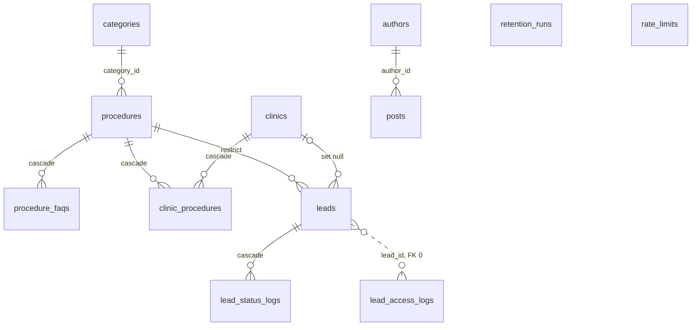

# 데이터 정의서 (30-data) — v1 (1쪽 요약, ≤ 120줄)
- 2026-10-25 · owner `spec-data-architect` · 교차 검토 `spec-tech-lead`·`spec-analytics-lead`. 우선순위 3위(95 > 00 > **30·70** > 40). 다른 파일은 고치지 않는다(T-088 일괄).
- 입력: README, 00 v3.1, 70 v1.2(3-5b·3-8·4-2), 95 v3(3-12 DR1~DR10), screen-spec 8절, `supabase/migrations/20261025000000_content_tables.sql`, `data/seed/*.json` 5개. ID: 충돌 `SC-01`~, 질문 `SQ-01`~(00 C·Q, 95 K, 70 EC·EQ, 10 DC·DQ와 겹치지 않음). 완본은 구현 중 보강.

## 1. 목적과 범위
| 결정하는 것 | 결정하지 않는 것 (원본) |
| --- | --- |
| 테이블 12개(콘텐츠 7 + 리드 계열 5)의 컬럼·타입·제약·인덱스, ERD, 개인정보 등급, 암호화 방식 확정, 보존·삭제 규칙, 시드 규칙, RLS | Edge Function 입력·출력·오류(70), 동의 고지문(95·20), 이벤트 21개(40), 금지 표현(95), 화면 문구(20) |

## 2. 원칙
1. **정본은 seed JSON, DB는 사본**: 콘텐츠를 DB에서 직접 고치는 경로 0. seed·DB id가 1개라도 다르면 빌드 실패(70 3-1).
2. **개인정보는 리드 계열 5개 테이블에만**: 브라우저(anon·authenticated) 권한 0, 접근은 Edge Function(service role)과 pg_cron뿐.
3. **삭제 기준 컬럼 1개 `retention_until`, 삭제 실행자 1개 pg_cron `retention-daily`**(95 3-5).
4. **가짜는 `is_demo`로 구분하고 실리드 집계에 섞이지 않는다**: 판정 입력은 `x-internal-token` 헤더 1개(00 Q10).
5. **화면에 나오지 않는 값은 공개 테이블에 두지 않는다**: 근거 없는 숫자 컬럼(`view_count`) 삭제, 가격은 조사일·출처가 있는 행만.

## 3. 규칙
### 3-1 ERD (12개)

### 3-2 테이블·컬럼 (등급: 공개 = anon select 허용 / 개인 / 민감 = 건강 관련)
| 테이블 | 컬럼: 타입 · 제약 (굵게 = 이 문서가 바꾼 것) | 인덱스 | 등급 |
| --- | --- | --- | --- |
| categories, authors, procedure_faqs, posts | 현행 마이그레이션 유지. **authors.kind** `text not null default 'editorial' check in ('editorial','reviewer')` — 자문의 행(95 S4)은 사람 승인 후에만, 가상 의사명 0 | 현행 | 공개 |
| procedures | `id text pk`, `category_id` FK, `slug` unique, `summary text not null`, `price_low/high int ≥ 0 · low ≤ high`, `price_note`, `duration_min`, **`recovery_days int` = 일상 복귀 상한 1개**(T-013), `anesthesia`, `sources jsonb [{title, org, url, doi?, pmid?}]`, `updated_at date`. **`view_count` 삭제**(EC-20) | `(category_id)` | 공개 |
| clinics | 현행 컬럼 유지(`specialties text[]`, `is_demo`). **추가 check**: `not is_demo or (not is_partner and not is_premium and phone is null and kakao_url is null and ad_review_no is null)`(95 3-7) | `slug` unique | 공개 |
| clinic_procedures | `pk(clinic_id, procedure_id)`, `price_low/high`, `price_note`, `duration_min`, `price_updated_at date`(= 조사일), **`price_source_url text null`**(공개 가격 페이지, 경로 길이 > 1). check: `price_source_url is null or (price_low is not null and price_high is not null)` | `(procedure_id)` | 공개 |
| leads — 키·본문 | `id uuid pk default gen_random_uuid()`, `receipt_no text not null unique check ~ '^RS-[0-9]{6}-[0-9A-F]{6}$'`, `idempotency_key uuid not null unique`, `procedure_id` FK restrict(**민감**), `clinic_id` FK set null, `name text not null`(1~20자, 평문), `phone text not null`(암호문), `phone_hash text not null`(64자), `region`·`timing`·`contact_time text not null`(enum 3-2b), `memo text null`(암호문, **민감**), `status text not null default '신규'`(5종), `created_at timestamptz not null default now()` | `(phone_hash, created_at)`, `(status, created_at)`, `(procedure_id)` | 개인·민감 |
| leads — 동의 | `consent_privacy`·`consent_sensitive bool not null check (true)`(DR1), `consent_3rd bool null`(DR2, A3 미표시 = null), `consent_marketing bool not null`, `age_confirmed bool not null check (age_confirmed)`(T-017 만 14세 미만 차단), `consent_version text not null`(YYYY-MM-DD), `consented_at timestamptz not null`, `withdrawn_at timestamptz null`(DR3) | — | 개인 |
| leads — 신호·유입 | `ad_consent`·`analytics_consent bool not null`, `fbc`·`fbp text ≤ 255 null`, `ga_client_id text ≤ 64 null`, `utm_source/medium/campaign/content text ≤ 100`, `gclid`·`fbclid ≤ 255`, `landing_page ≤ 512`, `landing_referrer_host ≤ 255` (전부 null 허용). check: `ad_consent or (fbc is null and fbp is null)`, `analytics_consent or ga_client_id is null`, utm_* `~ '^[ -~]*$'`(ASCII), `landing_page !~ '[?#]'`, `landing_referrer_host !~ '[/:?#]'` | `(utm_source, created_at)` | 개인 |
| leads — 보존·데모 | `is_demo bool not null default false`(DR4), `retention_until timestamptz not null`(DR5). check: `not is_demo or retention_until <= created_at + interval '7 days'` | `(retention_until)`, `(is_demo, created_at)` | 운영 플래그 |
| lead_status_logs | `id bigint identity pk`, `lead_id uuid not null` FK **cascade**(DR7), `from_status text null`(최초 행), `to_status text not null`, `changed_by uuid null`(시스템 = null), `note text ≤ 200 null`(이름·전화 0), `changed_at timestamptz not null default now()` | `(lead_id, changed_at)` | 개인(가명) |
| lead_access_logs | `id bigint identity pk`, `lead_id uuid null`(FK 0, DR8), `admin_id uuid not null`, `action text check in (view_list, decrypt_phone, decrypt_memo, status_change, export_csv, withdraw)`, `at timestamptz not null default now()`. check: `lead_id is not null or action in ('view_list','export_csv')` | `(at)`, `(lead_id)` | 개인(가명) |
| retention_runs | `id bigint identity pk`, `run_at timestamptz default now()`, `deleted_leads`·`deleted_access_logs`·**`deleted_rate_limits`** `int not null`, `status text check in ('ok','error')` | `(run_at desc)` | 건수만(개인 아님) |
| rate_limits | `ip_hash text not null`(HMAC), `fn text not null`, `at timestamptz not null default now()` | `(ip_hash, fn, at)`, `(at)` | 개인(가명) |

**3-2b enum (P-06·20 확정 전 기본값, SQ-04)**: `timing` ∈ `1m`·`3m`·`undecided`(screen-spec P-06). `contact_time` ∈ `am`(10~12시)·`pm`(12~15시)·`late`(15~18시)·`any`. `region` ∈ `seoul-gangnam`·`seoul-seocho`·`seoul-etc`·`gyeonggi`·`incheon`·`etc`. `status` ∈ 신규·연락중·예약확정·내원·취소(전이 5개는 70 EF-2).
**병원 수 2종 (T-028)**: "등록 병원 n곳" = `clinic_procedures` 행 수(가상 병원 포함, "예시 데이터" 뱃지). "가격 조사 병원 n곳" = `price_source_url is not null` AND `clinics.is_demo = false` AND `price_updated_at ≥ 오늘 − 30일` 행 수. 항상 조사 ≤ 등록(⊂). 카운터 컬럼 저장 0, `build-data`가 `data/generated/procedure-stats.json`에 계산(예: 가상 3곳만 있는 눈 시술 → 등록 3·조사 0 → "예시 가격" 라벨).

### 3-3 개인정보·암호화·보존·삭제
| 항목 | 규칙 |
| --- | --- |
| 암호화(70 3-8 기본값 확정) | `phone`·`memo` = AES-256-GCM, IV 12바이트 난수, `v1.<iv b64url>.<ct+tag b64url>`, 키 `LEAD_ENCRYPTION_KEY` 32바이트. `name`은 평문(95 3-6 근거). `phone_hash` = HMAC-SHA256(HKDF info "phone-hash", 숫자만 `^01[016789][0-9]{7,8}$`), IP는 info "ip-rate". 복호화는 `admin-leads`만. Meta 전송용 SHA-256 전화 컬럼 0 |
| `retention_until` 값 | 접수 `created_at + 365일` → 예약확정·내원·취소로 바뀐 시각 + 365일 → `is_demo`는 `created_at + 7일` 고정(상태 변경으로 연장 0) → 철회 `now()`(EF-2 `withdraw`: `withdrawn_at = retention_until = now()`, 다음 배치에서 삭제, 영업일 1일 안) |
| 보존 기간 | leads 위 값 / lead_access_logs 365일 / rate_limits 최대 48시간 / lead_status_logs = leads와 같이 cascade / retention_runs 삭제 0(하루 1행) |
| 삭제 실행 | pg_cron `retention-daily` `0 18 * * *`(UTC) → `public.run_retention()`(security definer, `search_path` 고정, `revoke execute from public, anon, authenticated`). 1 트랜잭션: leads `retention_until < now()` → access_logs `at < now() − 365일` → rate_limits `at < now() − 24시간` → retention_runs 1행. 실패 시 status `error` 행 별도 insert. 감시 = EF-5 + Actions `daily`(26시간) |
| 장부·백업 | leads는 365일 뒤 사라지므로 과거 KPI 장부 = 주간 커밋본 `reports/leads/agg.json`(건수만). Free 플랜 자동 백업 0(95 L14), 수동 dump는 리드 계열 5개 데이터 제외. 로그·커밋·dataLayer에 이름·전화 0 |

### 3-4 RLS
| 대상 | 정책 |
| --- | --- |
| 콘텐츠 7개 | RLS on + `select` 정책 1개씩(`to anon, authenticated using (true)`), insert/update/delete 정책 0 → 쓰기는 service role만. 공개 근거 = 화면에 그대로 보이는 값만 |
| 리드 계열 5개 | RLS on + 정책 0 + `revoke all on <table> from anon, authenticated` + 시퀀스 revoke + `supabase_realtime` publication 포함 0(95 DR10, 70 3-8). 접근: EF-1 insert, EF-2 read·복호화, EF-4 건수, pg_cron |
| 새 테이블 | 기본 RLS on + 정책 0. 공개 select는 "화면에 그대로 보이는 값" 사유 1줄과 함께 |

### 3-5 시드 규칙
| # | 규칙 | 검사 |
| --- | --- | --- |
| S1 | 정본 `data/seed/{categories,authors,procedures,clinics,posts}.json` 5개 → 테이블 7개(procedures 안 `faqs` → procedure_faqs, clinics 안 `procedures` → clinic_procedures). `pnpm data:sql` → `supabase/seed.sql`. id `[a-z0-9-]+`, slug 한글 허용 | seed·DB id 비교(70) |
| S2 | 병원 전부 `is_demo = true` — 실존 병원 행 추가는 T-306 [human-gate] 승인 뒤. 이름은 검색엔진 2곳 동명 실존 0 확인 기록 `reports/ops/clinic-name-check.md`(3곳 현재 기록 0). 가상 병원 가격 인용 문장 "(예시 데이터)". 금지 키 `doctor`·`rating`·`review`·`score`·`rank`·`view_count`, 금지 문자열 "테스트"·"샘플"·`lorem` 0, 리드 시드 행 0 | 기록 파일 존재, `rg` 0건 |
| S4 | 가격: 1만 원 단위, `low ≤ high`, 조사일 ≤ 오늘. 가격 조사 병원 < 5곳 또는 30일 경과 시술은 `summary`·FAQ 답변·JSON-LD에 금액 `[0-9]+만` 0(00 3-8-4). 현재 seed 20줄 위반(SC-05) | `rg '[0-9]+만' data/seed/procedures.json` |
| S5 | `sources[]`는 `org`·`url` 필수. 완본 시술은 url 경로 길이 > 1 또는 doi·pmid, 서로 다른 org ≥ 3(00 F2). 비완본은 루트 URL 허용 + 빌드 경고. 현재 url 30개 중 약 21개가 루트(Q14) | build-data |
| S6 | e2e·QA 리드는 `x-internal-token` 일치 요청만 `is_demo = true`(`utm_source=internal` 단독 무효), 이름 "내부 점검", 전화 `010-0000-0000`, 7일 뒤 삭제. is_demo 행은 metrics-agg·KPI·Resend·CAPI·GA4 MP에서 제외 | 단위 테스트(70 3-12) |
| S7 | `metrics-agg`가 읽는 컬럼 = `utm_source`·`utm_medium`·`landing_referrer_host`·`is_demo`·`created_at`·첫 연락중 `changed_at`. 출력 = `by_source` 8키·`total`·`is_demo_excluded`·`sla` 건수뿐 | agg.json 행 값 0 |
| S8 | 유입 순서(70 3-10): attribution 기록(`fbclid` → `fb.1.<ms>.<fbclid>`) → `replaceState` 쿼리 제거 → 픽셀 로드. DB에는 경로·호스트만. 사이트 전역 `<meta name="referrer" content="strict-origin">`, 픽셀 `dl`·`rl` 디코딩 한글 0은 70 QG-07이 검사 | 컬럼 check + QG-07 |

## 4. 다른 정의서와의 접점
| 정의서 | 30이 받는 것 | 30이 주는 것 | 충돌 시 |
| --- | --- | --- | --- |
| 95 | DR1~DR10, 보존·파기 배치, is_demo, 동의 4개 | 컬럼·check·cron 구현 | 95 우선 |
| 00 | agg.json 형식, Q10, Q14, F2·F6 | 시드 규칙 S3~S5, 병원 수 2종 | 00 우선 |
| 70 | 3-5b 표, EF 순서, 암호 기본값 | 타입·enum·암호 확정 | 같은 순위 → spec-question |
| 40·50·20·10 | 이벤트·URL·문구·뱃지 | `landing_page` 경로, enum 코드(ASCII), 가격 라벨 입력 | 40·50 우선(스키마), 30 우선(저장) |

**충돌 기록 (T-088 일괄 정리, 다른 파일 수정 0)**
1. SC-01 — 95 DR8 action 5종 ↔ 70 `withdraw` 6종 + `lead_id` null(EC-18) / 95 DR9 retention_runs 4열 ↔ 70 `deleted_rate_limits`(EC-19) / 95 DR10 RLS 4테이블 ↔ 70 rate_limits 포함 5. 30 = 6종(null은 `view_list`·`export_csv`만)·5열·5테이블.
2. SC-02 — 95 3-7 QA 리드 `utm_source=internal` ↔ 00 Q10·70 `x-internal-token`. 30 = 토큰(T-016 `is_demo` 컬럼 유지, 판정 입력만 변경).
3. SC-03 — T-017 "CAPI 해시 전화를 제3자 제공 동의에 포함" ↔ 95 3-6·70 EF-1 해시 전화 0(EC-12). 30 = 해시 컬럼 0, 전송 시점 계산(SQ-05).
4. SC-04 — screen-spec 8절 leads `referrer`·`consent_*` 3개·`campaigns`·`affiliate_items`·`aeo_checks` ↔ 70 3-5b 컬럼, 00 `affiliate_items.json`·`aeo_checks.csv`. 30 = DB 테이블 12개만, 3개는 JSON·CSV.
5. SC-05 — seed `summary`·FAQ 금액 20줄, 루트 URL 약 21개 ↔ 00 3-8-4·F2. 시드 정리 작업 필요(30은 규칙만).
6. SC-06 — 마이그레이션 `view_count` ↔ 00 Q14. 30 = 새 마이그레이션 `drop column view_count`(기존 파일 수정 0, EC-20).
7. SC-07 — 00 F6 frontmatter `price_sources[]` ↔ 30 `clinic_procedures.price_source_url`(T-028). 30 = DB·seed가 정본, MDX 사본 0.
8. SC-08 — 70 3-5b `age_confirmed`는 95 DR 목록 밖(EC-14). 30 채택, 95 DR 추가 필요.

**spec-question 후보 (기본값으로 진행)**
- SQ-01 T-005 추인(`price_note`·`sources`·`specialties`·`is_demo`·`authors` 5개): 기본값 전부 유지(마이그레이션 반영 완료).
- SQ-02 조사 병원 ⊂ 등록 병원 산식(3-2) 승인: 기본값 `price_source_url` 유무로 분리, 카운터 저장 0.
- SQ-03 T-013 범위 표시용 `recovery_days_min` 추가: 기본값 추가 0, 상한 정수 1개.
- SQ-04 `region` 6·`contact_time` 4 enum 확정(P-06·20): 기본값 3-2b 값.
- SQ-05 T-017 해시 전화 CAPI 전송(95·40 갱신 시): 기본값 컬럼 0, EF에서 복호화 후 즉시 SHA-256, 저장 0.

## 5. 검수 체크리스트
- [ ] `information_schema.tables` public 스키마 = 12행, 리드 계열 5개는 `pg_policies` 0행이고 anon 키 `/rest/v1/<table>` select가 5개 모두 401 또는 403
- [ ] `/rest/v1/procedures?select=view_count` → 400(컬럼 없음), P-01·P-03 화면에 조회수 숫자 0개
- [ ] `select count(*) from leads where is_demo and retention_until > created_at + interval '7 days'` = 0
- [ ] `retention-daily` 실행 직후 `retention_until < now()` 행 0, `retention_runs` 최신 행 `status='ok'` + `deleted_rate_limits` 값 존재
- [ ] 철회(`withdraw` all) → `withdrawn_at = retention_until`(±60초), 다음 배치 뒤 leads·lead_status_logs 0행, lead_access_logs `withdraw` 행 유지
- [ ] `select count(*) from leads where phone !~ '^v1\.' or (memo is not null and memo !~ '^v1\.')` = 0
- [ ] 같은 `idempotency_key` 재제출 → leads 행 +0. `select count(*) from leads where landing_page ~ '[?#]' or utm_source !~ '^[ -~]*$'` = 0
- [ ] `select count(*) from clinics where is_demo and (phone is not null or kakao_url is not null or ad_review_no is not null or is_partner)` = 0, P-05 가상 병원 3곳 "예시 데이터" 뱃지
- [ ] P-03 첫 화면의 "가격 조사 병원 n곳"과 "등록 병원 n곳"이 서로 다른 값이고 `procedure-stats.json` 10행 모두 조사 ≤ 등록
- [ ] `rg '"(view_count|doctor|rating|review)"|테스트|샘플|lorem' data/seed` 0건, 조사 병원 < 5곳 시술 페이지의 FAQ 가격 답변·3줄 요약에 금액 0개(S4)
- [ ] `lead_access_logs`에서 `lead_id is null and action not in ('view_list','export_csv')` 행 = 0

## 6. 변경 이력
- 2026-10-25 v1 (T-083): 1쪽 요약 초안. 테이블 12개·ERD·등급·암호·보존·RLS·시드 8규칙, 충돌 SC-01~08, 질문 SQ-01~05, 체크리스트 11항목. 교차 검토 전.
