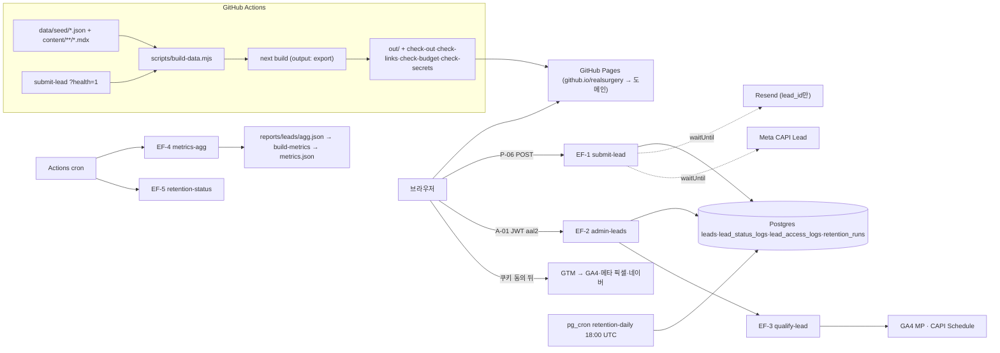

# 엔지니어링 정의서 (70-engineering) — v1.2 완본

- 버전 v1.2 · 2026-10-25 · owner `spec-tech-lead` · 교차 검토 `spec-data-architect`·`spec-analytics-lead` (08-specs 배정표)
- 우선순위 3위(README: 95 > 00 > **30·70** > 40 > 50 > 80 > 10 > 20 > 60). 95·00과 다르면 95·00을 따르고 4-2 충돌 기록(EC)·4-3 질문(EQ)에 남긴다. 이 문서는 다른 파일을 고치지 않는다(T-088 일괄 정리).
- 입력: `docs/specs/README.md`, `00-product` v3.1, `10-design` v2, `90-deliverables` v3, `95-legal-ops` v3, `docs/BENCHMARK.md` v1.3, `docs/QUALITY.md` v2, `docs/spec/screen-spec.md`(파생물), CLAUDE.md 기술 기본값, 코드(2026-10-25 작업트리): `package.json`, `next.config.ts`, `lib/env.ts`·`env.public.ts`·`consent.ts`·`track.ts`, `scripts/check-out.mjs`·`check-links.mjs`·`check-density.mjs`·`lh.mjs`·`lint-spec.mjs`, `.github/workflows/pages.yml`, `supabase/migrations/20261025000000_content_tables.sql`, `playwright.config.ts`, `vitest.config.mts`, `tests/e2e/flow.spec.ts`.
- 외부 문서 확인(2026-10-25): Next.js "Static Exports" 가이드(지원·미지원 기능 목록), Supabase "Edge Functions Secrets"(기본 주입 변수, `SUPABASE_` 접두 예약).
- ID: 품질 게이트 `QG-01`~, 성능 예산 `PB-01`~, Edge Function `EF-1`~`EF-5`, 충돌 `EC-01`~, 질문 `EQ-01`~. 00의 C·Q·G, 95의 K, 10의 DC·DQ와 겹치지 않는다.
- 완본 표기 사유: README 타임박스 "M1 전 완본 = 00·70·40·50·90·95".

## 0. 1쪽 요약 (구현자용)

1. 서버 0대. Next.js 15 `output: "export"` → `out/` → GitHub Pages. 서버 로직은 Supabase Edge Functions 5개(3-5)만. Route Handler(요청 의존)·SSR·ISR·middleware·Server Actions 0.
2. 브라우저 → Supabase REST(`/rest/v1/`) 요청 0. 콘텐츠는 빌드 때 `data/generated/*.json`으로 굽는다. 브라우저가 부르는 것은 `submit-lead`(P-06)·`admin-leads`(A-01)·Supabase Auth(A-01)뿐.
3. leads 계열 5개 테이블(leads·lead_status_logs·lead_access_logs·retention_runs·rate_limits): RLS 켬 + 정책 0 + `anon`·`authenticated` 권한 회수. 전화·메모는 Edge에서 AES-256-GCM 암호화.
4. P-06 제출 모드 3개(`live`·`closed`·`demo`)를 빌드 때 `data/generated/lead-mode.json`에 고정. 키 4종이 없으면 `closed`(00 S8 = T-029 결정 전 기본값). T-029가 (가)로 나면 GitHub Variable `LEAD_MOCK_MODE=demo`만 바꾼다(코드 변경 0).
5. 내부·심사용 리드 = `x-internal-token` 헤더(00 Q10). e2e는 Playwright `page.route`로 헤더를 붙이고, 토큰 값은 `out/`에 0회.
6. 태그는 `dataLayer.push`만. GTM 로더는 쿠키 동의(분석 또는 광고) 뒤에만 삽입. `gtag(`·`fbq(`·`wcslog` 하드코딩 0.
7. GitHub Pages는 응답 헤더를 못 바꾼다 → `<meta name="referrer" content="strict-origin">` + `<meta http-equiv="Content-Security-Policy">` 2개로 대체. `frame-ancestors`·HSTS·301 설정은 불가(3-2).
8. 예산: 이용자 화면 첫 로드 JS gzip ≤ 150KB, Lighthouse 모바일 LCP ≤ 2.0s·CLS ≤ 0.05, BENCHMARK B-15~B-20 수치(3-11).
9. CI: `build` → `e2e` → `deploy`(main) → `post-deploy`(배포 URL e2e·밀도·Lighthouse). cron 2개: 매일 00:00 UTC 파기 감시, 매주 월 01:00 UTC 지표 집계.
10. 파일·폴더 이름 ASCII, 인코딩 UTF-8 명시, `basePath`는 환경 변수로만(`/realsurgery` 하드코딩 0).
11. 동의 전 dataLayer 큐는 로더 직전 비우고 현재 페이지 view 1건만 다시 넣는다. 철회 = denied push + 쿠키 삭제 + 새로고침. 유입 기록은 `lib/attribution.ts` 1곳(쿼리 제거 전 fbc).
12. 콘텐츠 정본 = `data/seed/*.json`. DB는 동기화본, seed·DB id가 1개라도 다르면 빌드 실패.

## 1. 목적과 범위

| 이 문서가 결정하는 것 | 이 문서가 결정하지 않는 것 (원본) |
| --- | --- |
| 아키텍처·배포 경로·정적 export 제약 (3-1·3-2) | 컬럼 타입·제약·시드 규칙 (30-data) |
| basePath → 도메인 전환 절차(T-000) (3-3) | 이벤트 21개 이름·파라미터·GTM 태그 구성 (40-tracking) |
| 폴더 구조·파일 배치 (3-4) | URL 최종 형식·sitemap 구조·JSON-LD (50-seo-aeo) |
| Edge Function 5개 계약: 입력·출력·오류·부수 효과 순서 (3-5) | 동의 항목·보존 기간·금지 표현 (95-legal-ops) |
| 리드 제출 모드·mock 모드 규칙 (3-6·3-9) | 화면 문구·오류 문장 원문 (20-content) |
| 키 분리·RLS·암호화·관리자 인증·referrer·CSP (3-7·3-8) | 색·간격·컴포넌트 상태 (10-design) |
| 태그 삽입 시점·하드코딩 검사 (3-10) | KPI 정의·목표값 (00-product) |
| 성능 예산·테스트 전략·품질 게이트·CI·cron (3-11~3-14) | 제출물 양식 (90-deliverables) |
| 인코딩·ASCII 파일명 검사 (3-15) | 암호화 알고리즘 최종안(30, 95 4절) — 30 확정 전 3-8 기본값으로 구현 |

### 가정 (무인 모드, 2026-10-25)
- 가정: Supabase 플랜 = Free(비용 0원, 자동 백업 0, 7일 미사용 시 일시 정지 → keep-alive cron). Pro 전환은 비용 항목(EQ-03).
- 가정: Supabase 리전 = 서울 ap-northeast-2(95 3-10).
- 가정: 도메인 이름 미정 → 이 문서는 `<도메인>`으로 쓴다. 연결 기한 2026-11-01(00 가정).
- 가정: T-029 결정 전 기본값 = `closed`(00 S8, 10 DQ-09). 인터페이스는 `demo`에서도 같은 함수로 동작(3-6).
- 가정: 제휴 병원 0곳(00 가정) → `qualify-lead` 호출 0회가 M4까지의 정상 상태.

## 2. 원칙

1. **빌드 때 끝낼 수 있는 일은 빌드 때 끝낸다**: 콘텐츠·병원·지표는 `pnpm build` 안에서 JSON으로 굽는다. 런타임 네트워크 요청은 쓰기(리드)·관리자·동의 후 태그 3종만. 예: P-03 첫 화면 렌더에 필요한 요청 = HTML 1 + JS ≤ 150KB + CSS 1, Supabase 0.
2. **비밀은 서버에만, 서버는 Edge뿐**: 비공개 키는 Edge 시크릿·GitHub Secrets·로컬 `.env.local` 3곳 밖에 0회. `out/`에서 비공개 키 값 검출 0(QG-10).
3. **키가 없어도 흐름은 멈추지 않고, 가짜는 진짜로 섞이지 않는다**: 키 없음 = mock 경로 + 로그 "mock 모드로 통과" + `needs-key`. mock·내부 리드가 leads·GA4·CAPI·KPI에 들어가는 경로 0(00 3-4, 95 3-7).
4. **게이트는 명령 1개 = 숫자 1개**: 모든 품질 판정은 종료 코드 0/1을 내는 명령으로 재현한다(3-13). 사람 눈 판정은 10·80 몫.
5. **main은 언제나 배포 가능**: main 머지 전 로컬 `pnpm build` 종료 코드 0, main CI 실패 시 다음 머지 0건(3-14).

## 3. 규칙

### 3-1 아키텍처



| 구성 요소 | 선택 | 수치·제약 |
| --- | --- | --- |
| 프런트 | Next.js 15 App Router + TypeScript 5 + Tailwind 4, React 19 | `output: "export"`, `trailingSlash: true`, `images.unoptimized: true`(현행 `next.config.ts`) |
| 호스팅 | GitHub Pages(Actions 배포) | 비용 0원. GitHub 문서 기준 사이트 ≤ 1GB, 대역폭 월 100GB(소프트) |
| DB·인증 | Supabase Postgres + Auth | Free 플랜(가정), 리전 ap-northeast-2 |
| 서버 로직 | Supabase Edge Functions(Deno) 5개 | 3-5 계약 외 함수 0 |
| 콘텐츠 정본 | `data/seed/*.json` + `content/**/*.mdx` | 빌드는 항상 seed를 읽는다(키 유무 무관). DB 콘텐츠 7테이블 = `pnpm data:sql`이 만든 `supabase/seed.sql`의 동기화본, EF-1은 DB `procedures.id`로 검증. 동기화 시점 = seed를 바꾼 브랜치를 main에 머지하기 전 로컬에서 `pnpm data:sql` → `npx supabase db push --include-seed` 1회. `build-data`는 Supabase 공개 키가 있으면 anon REST `procedures?select=id` 집합과 seed id 집합을 비교, 차이 ≥ 1개면 빌드 실패(id 목록 출력) — live 제출이 DB에 없는 id로 거부되는 상태가 배포되는 경로 0. DB 응답 없음(timeout 5,000ms·5xx·일시 정지) = 비교 건너뜀 + lead-mode를 `live`로 두지 않음(health도 실패하므로 `LEAD_MOCK_MODE` 값) + 로그 "seed·DB 비교 건너뜀: <사유>", 빌드는 계속. 업로드 키 = `SUPABASE_PROJECT_REF`·`SUPABASE_DB_PASSWORD`(CLI), `pnpm data:sql`은 SQL 파일 생성만(키 0) |
| 파기 | pg_cron `retention-daily` 1개 | 95 3-5 + rate_limits 삭제(보존 최대 48시간, 3-8) |
| 알림 | Resend | 본문 = lead_id + A-01 링크(95 3-5) |
| 태그 | GTM 1개 컨테이너 | 앱 코드는 `dataLayer.push`만(3-10) |
| 모니터링 | GitHub Actions 실패 메일 + GA4 | Sentry 0(EQ-04) |

### 3-2 정적 export·GitHub Pages — 되는 것 / 안 되는 것

| 기능 | 가능 | 이 프로젝트의 대응 (숫자·예) |
| --- | --- | --- |
| Server Component 빌드 시 렌더 | 예 | 콘텐츠 조회는 빌드 때 1회. 런타임 Supabase 조회 0 |
| 동적 라우트 + `generateStaticParams` | 예 | `/procedures/[slug]` 10개, `dynamicParams = false` 고정 |
| `dynamicParams: true`·`generateStaticParams` 없는 동적 라우트 | 아니오 | 사용 0. 시드에 없는 slug = `out/404.html` |
| Route Handler GET + `dynamic = "force-static"` | 예 | `sitemap.xml`·`robots.txt`·`llms.txt` 정적 파일 생성에만 |
| Request를 읽는 Route Handler·POST | 아니오 | 쓰기는 EF-1 |
| `cookies()`·`headers()`·SSR·ISR·Server Actions·Draft Mode·Intercepting Routes | 아니오 | 사용 0. `pnpm build`가 실패하면 그 기능을 쓴 것 |
| middleware(proxy)·`next.config` rewrites·redirects·headers | 아니오 | 리다이렉트는 3-3 도메인 전환(GitHub 자동 301) 1종뿐. 영문 별칭 301 0(EC-06) |
| `next/image` 기본 로더 최적화 | 아니오 | `unoptimized` + 미리 변환한 WebP·AVIF(`docs/IMAGES.md`), `width`·`height` 필수(check-out) |
| 클라이언트 컴포넌트·`next/link`·`not-found.tsx` | 예 | 404 = `out/404.html`(GitHub Pages가 상태 404로 응답) |
| 응답 헤더(CSP·HSTS·X-Frame-Options·Referrer-Policy·Permissions-Policy·Cache-Control) | 아니오 | meta 대체 2개(referrer·CSP, 3-8). 나머지 대체 0. 캐시는 GitHub 고정값(`max-age=600`) |
| 쿼리별 HTML(`/procedures?cat=eye`) | 아니오 | 앵커형 `#cat-{id}`(10 DQ-14 기본값) |
| A/B 변형 서버 분기 | 아니오 | 변형마다 별도 정적 경로(예 A `/lp/c2611a/`, B `/lp/c2611b/`), 클라이언트 교체 0 → CLS 0(EC-15) |
| 한글 경로 | 예 | `out/procedures/쌍꺼풀-수술/index.html`(디렉터리 이름 = 디코딩된 한글), 링크·sitemap·canonical은 퍼센트 인코딩 |

### 3-3 basePath·도메인 전환 (T-000)

현재: `https://jaehoonkor.github.io/realsurgery/`, basePath `/realsurgery`(Actions `configure-pages` 출력 또는 Variable). 코드에 `/realsurgery` 문자열 0(`next.config.ts` 주석·테스트 기본값 제외, EC-10) — 경로는 `withBasePath()`·`siteUrl()`(`lib/env.public.ts`)로만 만든다.

| # | 단계 | 담당 | 확인 (명령·숫자) |
| --- | --- | --- | --- |
| 1 | 도메인 구매(T-000 승인됨) | 사람 | TASKS T-000 상태 |
| 2 | DNS: apex A 4개 `185.199.108.153`·`.109.153`·`.110.153`·`.111.153` 또는 `www` CNAME `jaehoonkor.github.io` | 사람 | `nslookup <도메인>` 결과 IP 4개 |
| 3 | 저장소 Settings › Pages › Custom domain 입력 → DNS check 통과 → Enforce HTTPS | 사람 | 인증서 발급 최대 24시간(00 S1) |
| 4 | GitHub Variables: `NEXT_PUBLIC_BASE_PATH` 삭제(빈값이면 `configure-pages` 출력 `""` 사용), `NEXT_PUBLIC_SITE_URL=https://<도메인>`. `.env.local` 같은 값 | 사람·오케스트레이터 | `gh variable list` 2행 |
| 5 | Edge 시크릿 `ALLOWED_ORIGINS`에 `https://<도메인>` 추가(github.io 출처는 7일 유지 후 삭제) | 사람 | `npx supabase secrets list` |
| 6 | `workflow_dispatch`로 main 재배포 | 오케스트레이터 | Actions 실행 1회 green |
| 7 | 검증 | 오케스트레이터 | `out/**/*.html`에 `/realsurgery/` 0회 · canonical·`og:url`·sitemap `<loc>` 100%가 `https://<도메인>/`로 시작 · `curl -I https://<도메인>/robots.txt`·`/sitemap.xml`·`/llms.txt` 각 200 · `curl -I https://jaehoonkor.github.io/realsurgery/` 301 + `Location: https://<도메인>/` |
| 8 | `reports/ops/milestones.json`의 `domain_connected_at` 기록 → 00 S2·S3(서치콘솔 도메인 속성·서치어드바이저) | 사람·오케스트레이터 | 00 3-9-3 판정 입력 |
| 9 | 트래킹: GA4 데이터 스트림 URL·메타 도메인 인증·GTM 컨테이너 대상 도메인 갱신. 출처가 바뀌어 `_ga` 쿠키가 이어지지 않음 → D4·`/insights#funnel`에 "도메인 전환일 YYYY-MM-DD 전후 사용자 수 단절" 1줄 | 사람·tracker | GA4 실시간 보고서에 도메인 출처 세션 ≥ 1 |

- 도메인 전 github.io 하위 경로의 `/realsurgery/robots.txt`·`/realsurgery/llms.txt`는 생성은 하되 크롤러 기준 무효(00 C20).
- 인증 메타(`NEXT_PUBLIC_GOOGLE_SITE_VERIFICATION`·`NEXT_PUBLIC_NAVER_SITE_VERIFICATION`)는 빌드 때 정적 `<head>`에 출력(90 충돌 18). 값 변경 = 재배포 1회.

### 3-4 폴더 구조

```
app/(site)/            이용자 화면(P-01·P-03·P-05·P-06·P-07·P-12·C-01·/insights·404)
app/admin/             A-01 (noindex, robots Disallow, @supabase/auth 의존은 이 아래만)
components/{common,cards,charts,diagrams,icons,forms}/   PascalCase.tsx
content/procedures/<ascii-id>.mdx   한글은 frontmatter slug 값에만
data/seed/*.json        원본 시드(커밋)      data/generated/*.json  빌드 산출(.gitignore)
lib/                    env.ts(Node)·env.public.ts(브라우저)·track.ts·consent.ts·gtm.ts·attribution.ts·lead-client.ts·csp.ts
lib/metrics/*.ts        KPI 계산 순수 함수(build-metrics·ga4-report가 import) → vitest 커버리지 대상
supabase/migrations/    YYYYMMDDHHMMSS_<ascii>.sql
supabase/functions/<name>/index.ts      Deno 진입점 5개(3-5)
supabase/functions/_shared/*.ts         Deno 전역 0인 순수 TS(검증·분류·암호 포맷) → vitest 대상
supabase/config.toml    함수별 verify_jwt, auth enable_signup=false
scripts/*.mjs           빌드·검사 스크립트(.mjs·.ts·.ps1만)
tests/{unit,e2e,a11y,fixtures}/
reports/**              숫자·증거 단일 장부(90 원칙 4). reports/leads/*.csv는 .gitignore
public/                 정적 에셋. out/에 복사
```

- 새 최상위 폴더 0개(위 목록 밖). `app/`에 `route.ts`는 `force-static` GET 3개(sitemap·robots·llms)만.
- `@supabase/supabase-js`(또는 `@supabase/auth-js`) import 위치 = `app/admin/**`·`lib/admin-*.ts`만. 이용자 화면 번들 포함 0(PB-01).

### 3-5 Edge Function 계약

**공통 (EF-1~EF-5)**
| 항목 | 규칙 |
| --- | --- |
| 호출 URL | `${NEXT_PUBLIC_SUPABASE_URL}/functions/v1/<name>` |
| JWT 검증 | `supabase/config.toml`: EF-2만 `verify_jwt = true`, 나머지 4개 `false` + 함수 안 자체 검증 |
| CORS | Edge 시크릿 `ALLOWED_ORIGINS`(쉼표 목록, 예 `https://jaehoonkor.github.io,https://<도메인>,http://localhost:3000,http://localhost:4173,http://localhost:4174`). 목록 밖 Origin = 403 `ORIGIN` + CORS 헤더 0. OPTIONS 204, `Access-Control-Allow-Headers: content-type, authorization, x-internal-token, x-meta-test`, `Access-Control-Max-Age: 600` |
| 본문 | `application/json; charset=utf-8`, 요청 ≤ 8,192바이트(초과 413 `TOO_LARGE`) |
| 오류 형식 | `{"error":{"code":"VALIDATION","fields":["phone"]}}`. 사람용 문장은 화면이 code로 고른다(20 원문, 10 3-3 ≤ 40자). 응답에 입력값 반사 0 |
| 로그 | 요청당 1행 JSON `{fn, request_id, status, code, ms, is_demo, mock}`. 이름·전화·메모·IP 원문·토큰 값 0(95 3-6). 키 없음 = `mock: true` + 문자열 "mock 모드로 통과" |
| 시간 | 응답 p95 ≤ 2,000ms. Resend·CAPI·GA4 MP는 응답 뒤 `EdgeRuntime.waitUntil`, 외부 호출 timeout 5,000ms |
| 토큰 비교 | 상수 시간 비교. 토큰 = 32바이트 난수 base64url(43자) |
| 서버 키 | Supabase 자동 주입 `SUPABASE_URL`·`SUPABASE_SERVICE_ROLE_KEY`(또는 `SUPABASE_SECRET_KEYS`). `SUPABASE_` 접두 시크릿 직접 등록 0(예약, EC-11) |

**EF-1 `submit-lead`** — 호출자: P-06·P-12 인라인 폼. `POST`(본문) / `GET ?health=1`(빌드 스크립트).

| 입력 필드 | 형식 | 필수 | 실패 code |
| --- | --- | --- | --- |
| `procedure_id` | procedures 테이블 id 1개 | 예 | VALIDATION |
| `clinic_id` | null 또는 `is_demo = false` 병원 id. `is_demo = true` id면 거부(00 3-1 가상 병원 동선) | 아니오 | CLINIC_DEMO |
| `region`·`timing`·`contact_time` | 값 목록 = 30-data enum, 각 ≤ 20자 | 예 | VALIDATION |
| `name` | 1~20자, URL·숫자 0 | 예 | VALIDATION |
| `phone` | `^01[016789]-?\d{3,4}-?\d{4}$` → 하이픈 제거 후 암호화 | 예 | VALIDATION |
| `memo` | 0~200자 | 아니오 | VALIDATION |
| `consent` | `{privacy: true, sensitive: true, third: true\|null, marketing: boolean, version: "YYYY-MM-DD", age_confirmed: true}` — third는 A3 표시 때만 true 필수, 미표시 null(95 3-6), age_confirmed는 T-017(EC-14), version은 Edge 상수 허용 판본 목록(현재 1개)에 없으면 거부(95 3-6 "고지문 바꾸면 version 갱신" 강제) | 예 | VALIDATION |
| `attribution` | `utm_source`·`utm_medium`·`utm_campaign`·`utm_content` 각 ≤ 100자, `gclid`·`fbclid` ≤ 255, `landing_page` 경로만 ≤ 512자(쿼리 0), `landing_referrer_host` 호스트만 ≤ 255 | 아니오 | VALIDATION |
| `signals` | `{ad_consent: boolean, analytics_consent: boolean, fbc, fbp, ga_client_id}` — fbc·fbp는 ad_consent true일 때만 값, ga_client_id는 analytics_consent true일 때만 값, 그 밖 null | 예 | VALIDATION |
| `idempotency_key` | UUID v4, 폼 세션당 1개 | 예 | VALIDATION |
| `hp` | 빈 문자열(숨김 필드) | 예 | REJECTED |
| 헤더 `x-internal-token` | 없음 또는 `INTERNAL_LEAD_TOKEN`과 같은 값 | 아니오 | INTERNAL_TOKEN |
| 헤더 `x-meta-test` | 없음 또는 `1`. `x-internal-token` 일치 요청에서만 효력(⑧ 예외) | 아니오 | — (토큰 없으면 무시) |

| 응답 | 본문 | 조건 |
| --- | --- | --- |
| 201 | `{"lead_id":"<uuid>","receipt_no":"RS-261109-7F3A9C","is_demo":false}` | 새 insert. receipt_no = `RS-` + KST YYMMDD + `-` + 난수 6자리 hex 대문자(하루 16,777,216 조합). `UNIQUE` 위반 시 재생성 1회, 2회째 실패 = 500 INTERNAL |
| 200 | 위와 같은 본문 | 같은 `idempotency_key` 재요청(insert 0) |
| 200 (`GET ?health=1`) | `{"ready":true,"missing":[]}` 또는 `{"ready":false,"missing":["RESEND"]}` | 이름만, 값 0. 검사 4종 = SUPABASE·ADMIN_ACCOUNT(`ADMIN_EMAIL`)·LEAD_ENCRYPTION·RESEND(00 S8) |
| 400 | VALIDATION(`fields[]`) · CLINIC_DEMO · REJECTED | insert 0 |
| 401 | INTERNAL_TOKEN — 헤더가 있는데 값 불일치 | insert 0(내부 리드가 실리드로 세지는 경로 차단) |
| 403 / 405 / 413 | ORIGIN / METHOD / TOO_LARGE | insert 0 |
| 429 | RATE_LIMIT — 같은 IP 해시 10분 5회 초과, `Retry-After: 600` | insert 0 |
| 503 | NOT_READY — 4종 중 1개 이상 없음 | insert 0, 로그 mock |
| 500 | INTERNAL — insert 트랜잭션 실패 | insert 0(롤백) |

부수 효과 순서(고정): ① Origin·메서드·크기 ② 레이트 ③ 검증 ④ 토큰 → `is_demo` ⑤ 전화·메모 암호화 + `phone_hash` ⑥ leads 1행 + lead_status_logs `신규` 1행을 1트랜잭션, `retention_until` = created_at + 365일(is_demo면 + 7일, 95 3-5) ⑦ 응답 ⑧ waitUntil: Resend 1통(is_demo면 0, 60초 안, 95 3-5) · CAPI `Lead` 1건(is_demo·ad_consent false·`META_CAPI_TOKEN` 없음 중 1개면 0). CAPI `event_id = lead_id`, `event_source_url` = origin + path(쿼리 0), `user_data` = fbc·fbp·client_user_agent, IP·해시 전화·이름 0(95 3-6, EC-12·EC-13).
- ⑧ 예외 1개 — **Meta 중복 제거 테스트**(90 D4 "중복 제거" 캡처, T-204). 중복 제거 표시는 같은 `event_id`의 브라우저 Lead + 서버 Lead 2건이 모두 들어와야 나오므로 경로 2개를 함께 정의한다.

| 조건 (전부) | 서버 경로 (EF-1) | 브라우저 경로 (P-07) |
| --- | --- | --- |
| `x-internal-token` 일치(is_demo = true) + 헤더 `x-meta-test: 1` + `signals.ad_consent = true` + Edge `META_TEST_EVENT_CODE` 있음 | CAPI `Lead` 1건, `event_id = lead_id`, `test_event_code` 포함. 201 응답에 `"meta_test": true` 추가 | `rs_lead.meta_test = true`이고 광고 동의 granted일 때만 `dataLayer.push({event: "meta_test_lead", event_id: lead_id})` 1회. GTM 메타 픽셀 태그가 이 이벤트로 `Lead`(eventID = lead_id) 1건 발화, 테스트 코드 처리 방식은 40·GTM |
| 위 조건 1개라도 불충족(예 `ad_consent = false`) | CAPI 0, 응답 `meta_test` 키 0 | push 0 |

- 분리: `meta_test_lead`는 이벤트 21개 밖 전용 이름. GA4 태그 트리거 0, `generate_lead` push 0 유지, KPI·`metrics.json`·agg.json 집계 0(is_demo). Resend 0.
- 실행: 사람이 이벤트 관리자 "테스트 이벤트 → 브라우저 이벤트 테스트"에서 받은 URL로 `node scripts/meta-dedup-test.mjs --url "<그 URL>"` 1회(Playwright, 배포 URL, 광고 동의 클릭 → 토큰·`x-meta-test` 헤더 주입 → 제출 → P-07). 3-12 "배포 URL 동의 클릭 0" 규칙의 유일한 예외이며 실행 기록은 `reports/evidence/D4-meta-dedup-YYYYMMDD.png` 1장. 00 3-4 예외는 EC-24.

**EF-2 `admin-leads`** — 호출자: A-01. `POST {action, ...}`, 헤더 `Authorization: Bearer <Supabase Auth access token>`.

| 검사 | 실패 |
| --- | --- |
| JWT 유효(verify_jwt) | 401 AUTH |
| JWT `email` = Edge 시크릿 `ADMIN_EMAIL` | 403 NOT_ADMIN |
| JWT `aal` = `aal2`(TOTP MFA, 95 3-6) | 403 MFA_REQUIRED |
| 같은 관리자 복호화 10분 30회 초과 | 429 RATE_LIMIT |

| action | 입력 | 출력 | lead_access_logs (95 DR8) |
| --- | --- | --- | --- |
| `list` | `status?`, `from?`·`to?`(YYYY-MM-DD), `page`(1부터), 페이지당 50행 | 행: lead_id·created_at·receipt_no·name·`phone_masked`("010-****-1234")·procedure_id·region·timing·contact_time·`has_memo`·status·utm_source·is_demo·`sla_due_at`(다음 영업일 18:00 KST, 95 3-5) | `view_list` 1행/호출 |
| `decrypt_phone` | lead_id | `{phone}` | `decrypt_phone` 1행 |
| `decrypt_memo` | lead_id | `{memo}` | `decrypt_memo` 1행 |
| `status_change` | lead_id, `to`, `note` ≤ 200자 | `{status, changed_at}` + lead_status_logs 1행 + retention_until 갱신(예약확정·내원·취소 → 그 시각 + 365일, 95 3-5). `to = 예약확정`이면 EF-3 호출 | `status_change` 1행 |
| `withdraw` | lead_id, `scope`: `"all"` \| `"marketing"`, `channel`: `"phone"` \| `"email"` | `all` → `withdrawn_at = now()`, `retention_until = now()`(다음 `retention-daily`에서 삭제, 95 3-5 영업일 1일) / `marketing` → `consent_marketing = false`. 둘 다 lead_status_logs 1행(메모 "철회 {scope} · 접수 경로 {channel}", 예 "철회 all · 접수 경로 phone" — 95 3-6 철회 진입점별 처리 증빙) | `withdraw` 1행(95 DR8 enum 추가 = EC-18) |
| `export_csv` | from, to | `text/csv; charset=utf-8`(BOM 포함), 전화 마스킹, 메모 열 0 | `export_csv` 1행, lead_id null |

- 상태 전이 허용 5개: 신규→연락중, 연락중→예약확정, 예약확정→내원, 신규·연락중·예약확정→취소. 그 밖 400 TRANSITION. 없는 lead_id 404 NOT_FOUND.
- **is_demo 예외(95 3-5 보존 행 순서·3-7)**: `is_demo = true` 리드는 `status_change`에서 retention_until 갱신 0(created_at + 7일 유지). `withdraw`는 is_demo 여부와 무관하게 `now()`로만 당긴다(늘리는 경로 0).
- `view_list`·`export_csv`의 lead_access_logs.lead_id = null(목록 단위 기록).

**EF-3 `qualify-lead`** — 호출자: EF-2만. 헤더 `x-ops-token`(= `OPS_TOKEN`), `POST {lead_id, to}`.
| 조건 | 동작 | 출력 |
| --- | --- | --- |
| is_demo = true | 전송 0 | 200 `{"sent":{"ga4":false,"capi":false},"reason":"is_demo"}` |
| analytics_consent true + ga_client_id + `GA4_MP_API_SECRET` | GA4 MP `lead_qualified` 1건(값은 40 정의) | `sent.ga4 = true` |
| ad_consent true + `META_CAPI_TOKEN` | CAPI `Schedule`, `event_id = <lead_id>:schedule` | `sent.capi = true` |
| 토큰 불일치 / 없는 lead | — | 401 OPS_TOKEN / 404 NOT_FOUND |

- `lead_qualified`는 **서버 전용**(EF-3 GA4 MP 1경로). A-01 브라우저의 `track("lead_qualified")` 호출 0(이중 집계 방지, 3-10 검사). 수신 확인은 dataLayer 단언이 아니라 GA4 Data API `eventCount`(3-14 `metrics` 잡)로 한다.

**EF-4 `metrics-agg`** — 호출자: Actions `metrics` 잡. `GET ?from=YYYY-MM-DD&to=YYYY-MM-DD`, 헤더 `x-ops-token`.
- 출력(00 3-5 형식 + `sla` 키 1개 추가, 00 쪽 반영은 EC-26): `{"period":"2026-11-10~2026-11-16","by_source":{"naver_ads":0,"meta":0,"ai_referral":0,"naver_organic":0,"google_organic":0,"other_organic":0,"referral":0,"direct":0},"total":0,"is_demo_excluded":0,"sla":{"leads":0,"met":0}}`. 키 `by_source` 정확히 8개, 분류 순서 ①~⑧(00 3-5)은 `_shared/classify-source.ts` 1곳.
- 행 단위 값(이름·전화·메모·lead_id) 0. 오류: 401 OPS_TOKEN, 400 PERIOD(to < from 또는 기간 > 93일).

**EF-5 `retention-status`** — 호출자: Actions `daily` 잡. `GET`, 헤더 `x-ops-token`.
- 출력 `{"last_success_at":"2026-11-10T18:00:04Z","last_status":"ok","deleted_leads":0,"deleted_access_logs":0}`. Actions는 now − last_success_at > 26시간이면 잡 실패(95 3-5).

**3-5b 30-data에 넘기는 컬럼 요건** (EF가 읽고 쓰는 값. 타입 세부·이름 최종은 30, 95 DR1~DR10은 그대로)
| 테이블.컬럼 | 타입 힌트 | 제약·인덱스 | null | 출처 |
| --- | --- | --- | --- | --- |
| leads.receipt_no | text `RS-\d{6}-[0-9A-F]{6}` | `UNIQUE` | 아니오 | EF-1 201, 95 3-6 철회 조회키 |
| leads.idempotency_key | uuid | `UNIQUE` | 아니오 | EF-1 200 재요청 |
| leads.phone_hash | text(HMAC hex 64자) | 인덱스 `(phone_hash, created_at)` — 같은 전화 7일 판정(90 3-6 #10) | 아니오 | 3-8 암호화 |
| leads.phone · memo | text 암호문 `v1.…` | — | phone 아니오 · memo 예 | 95 DR6 |
| leads.consent_privacy · consent_sensitive · consent_marketing | boolean | — | 아니오 | 입력 `consent.privacy`·`sensitive`·`marketing` |
| leads.consent_3rd | boolean | — | 예(A3 미표시 = null) | 입력 `consent.third`, 95 DR2 |
| leads.age_confirmed | boolean | `check (age_confirmed)` | 아니오 | T-017, EC-14(95 DR 목록 밖) |
| leads.consent_version · consented_at · withdrawn_at | text · timestamptz · timestamptz | — | 아니오 · 아니오 · 예 | 95 DR3, EF-2 `withdraw` |
| leads.ad_consent · analytics_consent | boolean | — | 아니오 | 입력 `signals` |
| leads.fbc · fbp · ga_client_id | text ≤ 255 · ≤ 255 · ≤ 64 | 해당 동의 false면 null(check) | 예 | 입력 `signals` |
| leads.utm_source · utm_medium · utm_campaign · utm_content · gclid · fbclid · landing_page · landing_referrer_host | text(길이 = EF-1 표) | — | 예 | 입력 `attribution` 8키, 세션 첫 페이지뷰 1세트(3-10 attribution) |
| leads.is_demo · retention_until | boolean · timestamptz | 95 DR4·DR5 | 아니오 | EF-1 ④·⑥ |
| lead_access_logs.lead_id | uuid | FK 0(95 DR8) | **예** — `view_list`·`export_csv` | EF-2 |
| lead_access_logs.action | text enum | 95 DR8 5종 + `withdraw`(EC-18) | 아니오 | EF-2 |
| rate_limits(ip_hash, fn, at) | text · text · timestamptz | 인덱스 `(ip_hash, fn, at)` | 아니오 | EF-1 429, 보존 최대 48시간(3-8) |
| retention_runs.deleted_rate_limits | int | — | 아니오 | 3-8 파기 확장(95 DR9 컬럼 추가 = EC-19) |

### 3-6 리드 제출 모드 (T-029 두 안 모두 동작)

| 모드 | 결정 조건 (빌드 때) | P-06 화면 | 네트워크 | P-07 | generate_lead push | P-07 투명성 블록(10 TRK, 90 R5) |
| --- | --- | --- | --- | --- | --- | --- |
| `live` | `NEXT_PUBLIC_SUPABASE_URL` 있음 + `GET submit-lead?health=1` → `ready: true`(timeout 5,000ms) | 제출 활성 | EF-1 POST 1회 | receipt_no 표시 | is_demo false일 때 1회(lead_id당, sessionStorage 플래그) | is_demo false = 실제 push 객체 그대로. is_demo true = 아래 "예시" 표시 |
| `closed` (기본값) | 위 조건 불충족 + `LEAD_MOCK_MODE` 없음 또는 `closed` | 제출 버튼 `disabled` + "상담 접수 준비 중" + 링크 "시술 가이드 보기"(00 S8, 10 DQ-09) | 0 | 직접 접근 → `/consult/`로 `location.replace` | 0 | P-07 도달 0. `/insights#tracking` 공개 사본은 BDG-7 "예시 리포트" + 구조 |
| `demo` (T-029 (가)) | 위 조건 불충족 + GitHub Variable `LEAD_MOCK_MODE=demo` | 제출 활성 | 0 | 접수번호 `RS-YYMMDD-XXXXXX`(클라이언트 난수 6자리 hex) 표시, 화면 문자열 "mock"·"테스트"·"데모" 0 | 0 | BDG-7 "예시 리포트" 뱃지 + 1문장 "이 접수는 전환으로 기록되지 않았습니다"(원문 20) + 예시 객체. 실제 push처럼 보이는 표시 0 |

```ts
// lib/lead-client.ts — 세 모드 공통 인터페이스 (P-06·P-12가 이것만 부른다)
export type LeadMode = "live" | "closed" | "demo";
export type SubmitResult =
  | { ok: true; lead_id: string; receipt_no: string; is_demo: boolean; mode: LeadMode; meta_test?: true }
  | { ok: false; code: "VALIDATION" | "CLINIC_DEMO" | "RATE_LIMIT" | "NOT_READY" | "NETWORK" | "INTERNAL" | "CLOSED"; fields?: string[] };
export function leadMode(): LeadMode; // data/generated/lead-mode.json {mode, checked_at, missing[]}
export function submitLead(input: LeadInput, opts?: { signal?: AbortSignal }): Promise<SubmitResult>;
```

- 클라이언트 timeout 10,000ms → `NETWORK`, 입력값 보존, 재시도는 같은 `idempotency_key`(중복 insert 0).
- P-07 전달: sessionStorage `rs_lead` = `{lead_id, receipt_no, is_demo, mode, meta_test}`(meta_test는 EF-1 응답에 키가 있을 때만 true). 이름·전화 저장 0.
- TRK 블록의 "현재 Consent Mode 값" 줄은 클라이언트 JS가 필요 → PB-11 허용 목록에 포함(10 3-7-0이 TRK를 "JS 0"으로 분류한 것은 EC-22).
- 결정 후 전환: T-029 (가) → Variable 1개 변경 + 재배포. (나) → T-001 키 입력 → 다음 빌드에서 자동 `live`. 코드 변경 0.

### 3-7 키·환경 변수 분리

| 이름 | 공개 | 보관 위치 | 읽는 곳 | `hasKey` 묶음 |
| --- | --- | --- | --- | --- |
| `NEXT_PUBLIC_*` 11개(`lib/env.public.ts`) | 예(HTML·번들) | `.env.local`, GitHub **Variables** | 브라우저·빌드 | SUPABASE·GTM·GA4·META_PIXEL·NAVER_MAP |
| `SUPABASE_SERVICE_ROLE_KEY` | 아니오 | Edge 자동 주입 + 로컬 `.env.local`(로컬 관리 스크립트용, 시드 업로드에는 0 — 업로드는 DB 비밀번호로 `db push`) | Edge, 로컬 스크립트 | SUPABASE_ADMIN. GitHub 0 |
| `SUPABASE_PROJECT_REF`·`SUPABASE_DB_PASSWORD`·`ADMIN_PASSWORD` | 아니오 | 로컬 `.env.local`만 | `npx supabase` CLI, 관리자 계정 생성 1회 | SUPABASE_ADMIN·ADMIN_ACCOUNT |
| `ADMIN_EMAIL` | 아니오 | Edge 시크릿 + 로컬 | EF-1 health·EF-2 | ADMIN_ACCOUNT |
| `LEAD_ENCRYPTION_KEY`(32바이트 base64) | 아니오 | Edge 시크릿 + 사람 비밀번호 관리자 사본 1개 | EF-1·EF-2 | LEAD_ENCRYPTION. 분실 = 복호화 불가 |
| `RESEND_API_KEY`·`LEAD_NOTIFY_EMAIL` | 아니오 | Edge 시크릿 | EF-1 | RESEND |
| `META_CAPI_TOKEN`·`META_TEST_EVENT_CODE` | 아니오 | Edge 시크릿 | EF-1·EF-3 | META_CAPI |
| `GA4_MP_API_SECRET` (신규) | 아니오 | Edge 시크릿 | EF-3 | GA4_MP (신규) |
| `INTERNAL_LEAD_TOKEN` (신규) | 아니오 | Edge 시크릿 + GitHub **Secrets** + 로컬 | EF-1, e2e | INTERNAL_LEAD (신규) |
| `OPS_TOKEN` (신규) | 아니오 | Edge 시크릿 + GitHub Secrets | EF-3·EF-4·EF-5, Actions | OPS (신규) |
| `ALLOWED_ORIGINS` | 설정값 | Edge 시크릿 | EF-1~EF-5 | — |
| `GCP_SA_KEY_PATH`(`secrets/gcp-sa.json`) | 아니오 | 로컬 파일(.gitignore) / Actions는 Secret `GCP_SA_KEY_JSON`을 잡 시작 때 파일로 쓰고 끝에 삭제 | GA4 Data API·GTM API·서치콘솔 스크립트 | GCP·GA4_API·GTM_API·GSC |
| `GEMINI_API_KEY` | 아니오 | 로컬만 | `scripts/gen-image.mjs` | GEMINI |
| `LEAD_MOCK_MODE`·`CSP_GTM_PREVIEW`(평소 없음, 3-8)·`GA4_PROPERTY_ID`·`GTM_*`·`GSC_SITE_URL`·`INDEXNOW_KEY` | 설정값 | 로컬 + GitHub Variables | 빌드·스크립트 | — |

- 신규 4개 묶음(GA4_MP·INTERNAL_LEAD·OPS 등)은 T-109에서 `lib/env.ts` `KEYS`에 추가. 값은 로그·커밋·TASKS에 0회(`checkKey`는 이름만 반환, 현행).
- `NEXT_PUBLIC_GA4_MEASUREMENT_ID`·`NEXT_PUBLIC_META_PIXEL_ID`·`NEXT_PUBLIC_NAVER_ANALYTICS_ID`는 GTM 컨테이너가 ID를 보유하므로 `hasKey` 게이트 전용 — HTML·번들 출력 0(`out/`에서 값 검출 0).
- 브라우저 코드(`"use client"` 파일과 그 import)에서 `lib/env.ts` import 0(`node:fs` 포함 → 빌드 실패로도 드러남).

### 3-8 보안

**RLS·권한**
| 테이블 | anon·authenticated | 쓰기 | 근거 |
| --- | --- | --- | --- |
| categories·authors·procedures·procedure_faqs·clinics·clinic_procedures·posts | select 정책 1개(현행 마이그레이션) | service role만 | 공개 콘텐츠. `clinics.phone`·`is_partner`·`ad_review_no`도 anon으로 읽힘 — 화면(P-05 연락 버튼·심의번호 슬롯)에 그대로 보이는 값이고 가상 병원은 null(95 3-7), 제휴 0곳이면 값 0개 |
| leads·lead_status_logs·lead_access_logs·retention_runs·rate_limits(3-5b) | RLS 켬 + 정책 0 + `revoke all on <table> from anon, authenticated` | EF-1·EF-2·pg_cron | 95 DR10 |
| 새 테이블 | 기본 = RLS 켬 + 정책 0. 공개 select는 "화면에 그대로 보이는 값만" 사유 1줄과 함께 | — | — |

**브라우저 읽기 전용**: 이용자 화면 → `/rest/v1/` 요청 0, `/functions/v1/submit-lead` 외 Edge 요청 0. A-01 → Auth(`/auth/v1/`) + EF-2만. leads 직접 조회 0(95 3-6, EC-05). 확인: Playwright 네트워크 로그(QG-07).

**암호화** (알고리즘 최종 = 30, 그 전 기본값)
| 항목 | 규칙 |
| --- | --- |
| 대상 | leads.phone·leads.memo(95 DR6) |
| 방식 | AES-256-GCM(WebCrypto), 값마다 IV 12바이트 난수, 저장 형식 `v1.<iv b64url>.<ciphertext+tag b64url>` |
| 중복 판정용 | `phone_hash` = HMAC-SHA256(HKDF(`LEAD_ENCRYPTION_KEY`, info "phone-hash"), 정규화 전화) — 90 3-6 #10 "같은 전화 7일" 판정. 레이트용 IP도 같은 방식(info "ip-rate"), 원문 IP 저장 0, 보존 최대 48시간(아래 행) |
| 파생값 삭제 | pg_cron `retention-daily`(95 3-5, 매일 18:00 UTC, 1일 1회)가 같은 실행에서 `delete from rate_limits where at < now() - interval '24 hours'` → 실행 간격 24시간 + 조건 24시간 = 행 보존 **최대 48시간**(예: 17:59 UTC 삽입 → 다음 날 18:00 잔존 → 그다음 날 18:00 삭제). 레이트 판정에 쓰는 창은 10분이라 24시간 조건은 줄이지 않는다(배치 1개 유지), 건수는 retention_runs `deleted_rate_limits`(3-5b). `phone_hash`·`ga_client_id`는 leads 행과 함께 삭제. 95 3-6 수집 항목·처리방침에 `phone_hash`·IP 해시·`ga_client_id` 등재는 EC-19 |
| 키 교체 | 새 키 = `v2` 접두 + 이전 키 `LEAD_ENCRYPTION_KEY_V1` 보관, 재암호화 배치 완료 후 V1 삭제 |
| 전송 | HTTPS만(Pages Enforce HTTPS, Supabase 기본) |

**관리자(A-01)**: Supabase Auth 이메일·비밀번호 + TOTP MFA(aal2) 필수, `enable_signup = false`, 관리자 1명(`ADMIN_EMAIL`). 페이지 `noindex,nofollow` + robots `Disallow: /admin/`. 프레임 차단 헤더가 없으므로 `window.top !== window.self`면 본문 렌더 0(JS 1줄).

**referrer**: 루트 레이아웃 `<head>`에 `<meta name="referrer" content="strict-origin">` 1개 → 전 페이지. 외부로 나가는 Referer에 한글 slug 경로 0(origin만). 외부 링크 `rel="noopener"`, 제휴 링크 `sponsored nofollow noopener`(00 RM1).

**CSP** (meta, `lib/csp.ts` 1곳에서 생성, production 빌드에만)
| 지시어 | 값 |
| --- | --- |
| `default-src` | `'self'` |
| `script-src` | `'self' 'unsafe-inline' https://www.googletagmanager.com https://connect.facebook.net https://wcs.naver.net` |
| `connect-src` | `'self' <NEXT_PUBLIC_SUPABASE_URL> https://*.google-analytics.com https://*.analytics.google.com https://*.googletagmanager.com https://www.facebook.com https://wcs.naver.com` |
| `img-src` | `'self' data: https://*.google-analytics.com https://*.googletagmanager.com https://www.facebook.com` |
| `style-src` / `font-src` | `'self' 'unsafe-inline'` / `'self'` |
| `frame-src`·`object-src` | `'none'` (GTM noscript iframe 0) |
| `base-uri`·`form-action` | `'self'` |
| 기타 | `upgrade-insecure-requests` |

- 가능 범위: 외부 스크립트·연결 호스트 제한(위 목록 밖 차단). 불가: `frame-ancestors`·`report-uri`·`sandbox`(meta 미지원), nonce(서버 0). `'unsafe-inline'` 사유 = Next 정적 HTML의 인라인 RSC 스크립트·`app/layout.tsx` 동의·글꼴 인라인 스크립트. 해시 방식은 M2 이후 재검토.
- 호스트 목록 원본은 40(태그 구성) → 40 확정 시 `lib/csp.ts`만 갱신. 위반은 콘솔 "Refused to" → 동의 후 e2e(3-12, 태그 도메인 스텁)의 콘솔 0 게이트(QG-06)로 검출.
- **GTM Preview 전용 목록**(00 KPI-13(c)·90 D4 Preview 캡처용): 빌드 변수 `CSP_GTM_PREVIEW=1`일 때만 `lib/csp.ts`가 `script-src`·`style-src`에 `https://tagmanager.google.com`, `style-src`에 `https://fonts.googleapis.com`, `img-src`에 `https://ssl.gstatic.com https://www.gstatic.com`, `font-src`에 `https://fonts.gstatic.com`을 더한다. 절차: Variable 설정 → 재배포 → 캡처 1장 → Variable 삭제 → 재배포(배포 2회, 켜진 시간 ≤ 24시간). GTM Custom JavaScript 변수(`'unsafe-eval'` 필요) 사용 = 0개를 40이 확정(4-1).

**개인정보**: 로그·커밋·TASKS·Resend 본문·dataLayer에 이름·전화 원문 0(95 3-6). e2e 리드 = 이름 "내부 점검", 전화 `010-0000-0000`, `x-internal-token` 필수(95 3-7). 수동 DB dump에 leads 계열 0.

### 3-9 mock 모드 규칙

| 서비스 | 가드 | 키 없을 때 동작 | VERIFY 처리 |
| --- | --- | --- | --- |
| Supabase(공개) | `hasPublicKey("SUPABASE")` | `build-data`는 키와 무관하게 `data/seed/*.json`을 읽는다(3-1 콘텐츠 정본). 키 없음 = seed·DB id 비교 건너뜀 + lead-mode = `LEAD_MOCK_MODE` | needs-key(T-001) |
| Edge 4종(00 S8) | EF-1 health `missing[]` | P-06 `closed` 또는 `demo`, EF-1 직접 호출 시 503 | needs-key |
| GTM | `hasPublicKey("GTM")` | 로더 삽입 0, `dataLayer.push`는 그대로(e2e가 배열 검사) | 통과 |
| Meta CAPI·GA4 MP | Edge 안 키 확인 | 전송 0, 로그 mock | 통과 |
| GA4 Data API·GTM API·서치콘솔 | `hasKey("GA4_API")` 등 | `metrics.json` 값 `value: null, status: "needs-key"`(00 3-4) | needs-key |
| OPS 토큰 | Actions `secrets.OPS_TOKEN` 빈값 | `metrics`·`daily` 잡이 해당 단계 건너뜀 + 요약 "needs-key" | needs-key |
| INTERNAL_LEAD 토큰 | `process.env.INTERNAL_LEAD_TOKEN` 빈값 | e2e 제출 단계 `test.skip` + 사유 "needs-key: INTERNAL_LEAD_TOKEN" | needs-key(실패 아님, 통과도 아님) |
| Gemini | `hasKey("GEMINI")` | 브랜드색 SVG 플레이스홀더(CLAUDE.md) | 통과 |
| 네이버 지도 | `hasPublicKey("NAVER_MAP")` | 정적 지도 SVG + "네이버 지도에서 보기" 링크 | 통과 |

- 로그 문자열 고정: `mock 모드로 통과: <묶음 이름>`. 키가 들어오면 다음 루프가 needs-key 항목 재검증(CLAUDE.md).

### 3-10 태그 규칙

| 항목 | 규칙 | 검사 |
| --- | --- | --- |
| 앱 코드 | `track()`(`lib/track.ts`)·`pushConsent()`(`lib/consent.ts`)로 `window.dataLayer.push`만 | `gtag(`·`fbq(`·`gtag/js`·`fbevents`·`wcslog`·`wcs_do` 0(check-out 정규식 확장) |
| GTM 로더 | `lib/gtm.ts` 1곳, `NEXT_PUBLIC_GTM_ID` 있고 저장된 동의가 분석 또는 광고 granted일 때만 `gtm.js` 삽입. 동의 전 googletagmanager.com 요청 0(95 3-6 "동의 전 Google 태그 로드 0", EC-02) | Playwright 네트워크 |
| 동의 전 큐 | `track()`은 동의 전에도 `dataLayer`에 push(테스트·큐용, 전송 0). 로더 삽입 직전 `lib/gtm.ts`가 `dataLayer`에서 consent 명령 외 항목을 전부 제거하고, 현재 페이지의 `view_procedure`·`view_clinic`·`view_lp` 중 해당 1건만 다시 push. 동의 전 `form_start`·`scroll_depth` 등은 전송 0 → KPI-04 분자·분모 모두 동의 사용자(00 KPI-04 "모수 = 분석 동의 사용자"와 일치). 95 확인은 EC-21 | 단위 테스트: 큐 5건 → 로더 직전 consent 명령 + view 1건 |
| 동의 철회 | 푸터 "쿠키 설정"에서 해제 → ① `consent update` denied push ② 해당 범주 쿠키 삭제(분석 `_ga`·`_ga_*`·`_gid`, 광고 `_fbp`·`_fbc`, 경로 `/`·도메인 2종) ③ `location.reload()`. 다시 읽은 페이지는 두 범주 모두 denied면 로더 0, 한 범주만 남으면 로더는 넣되 철회 범주 신호 denied(95 3-6 "철회 이후 발화 0") | QG-07 "동의 → 철회 → 새로고침 뒤 철회 범주 호스트 요청 0" |
| 유입 기록 | `lib/attribution.ts` 1곳: 세션 첫 페이지뷰에서 1회 sessionStorage `rs_landing_referrer`(호스트)·`rs_utm`(utm 4키 + gclid·fbclid)·`rs_landing_page`(경로) 기록, 이미 있으면 덮어쓰기 0(00 3-5). `fbclid`가 있으면 쿼리 제거 **전에** `fb.1.<ms>.<fbclid>` 문자열을 `rs_fbc`에 저장, `_fbc` 쿠키는 광고 동의 granted 뒤에만 쓴다. 순서 고정: attribution 기록 → `history.replaceState`(P-12·P-06 쿼리 제거, 95 3-6) → 픽셀 로드. EF-1 `attribution`은 이 1세트(세션 첫 터치), last-click 추가 저장은 40 결정 후 30이 컬럼 확장(EC-23) | 단위 테스트: 기록 1회·덮어쓰기 0·fbc 형식·replaceState 뒤 값 유지 |
| `lead_qualified` | 서버 전용(EF-3). 앱 코드 `track("lead_qualified")` 호출 0. `lib/track.ts` 타입 정리·screen-spec 5절 발화 조건은 EC-25 | `rg "track\(\"lead_qualified\"" app components lib` 0 |
| 픽셀 URL 한글 | 메타 픽셀 요청 `dl`·`rl` 파라미터를 디코딩했을 때 한글 0자(95 3-6 시술명 0) | Playwright 네트워크(P-12·P-06·P-07) |
| Consent 기본값 | 4신호 denied, `ad_personalization`은 광고 동의여도 denied(95 3-6, EC-01) | 단위 테스트 |
| 인증 메타 | 서치콘솔·서치어드바이저 메타는 정적 `<head>`(90 충돌 18). 추적 태그 아님 | `out/index.html` grep |
| 메타 픽셀 범위 | P-12·P-06·P-07 3곳, 쿼리 제거 후 로드(95 3-6) — 구현은 40·GTM 트리거 | Playwright 네트워크 |

### 3-11 성능 예산

| ID | 항목 | 상한 | 측정 |
| --- | --- | --- | --- |
| PB-01 | 첫 로드 JS(gzip -9), 이용자 화면 경로마다 | ≤ 150KB | `scripts/check-budget.mjs`: `out/<경로>/index.html`의 `_next/static` `<script src>` 합계 |
| PB-02 | 첫 로드 JS, A-01 | ≤ 220KB | 같음 (Auth 클라이언트 포함) |
| PB-03 | HTML 1개 gzip / 원본 | ≤ 80KB / ≤ 400KB | 같음 |
| PB-04 | CSS 합계 gzip | ≤ 30KB | 같음 |
| PB-05 | Lighthouse 모바일(3회 중앙값, `scripts/lh.mjs`) | Perf ≥ 90, A11y ≥ 95, BP ≥ 95, SEO 100, LCP ≤ 2,000ms, CLS ≤ 0.05, TBT ≤ 200ms | 경로 4개: `/`, `/procedures/쌍꺼풀-수술/`, `/clinics/<첫 slug>/`, `/consult/` |
| PB-06 | 무쓰로틀 cold LCP(`bench-measure.mjs --cache cold --runs 3`) | B-15 ≤ 592ms(P-01 375), B-16 ≤ 888ms(P-03 375), B-17 ≤ 452ms(P-05), B-18 ≤ 568ms(P-06), B-19 ≤ 268ms(P-03 1280), B-20 clsMedian ≤ 0.004 | BENCHMARK 1절 조건 |
| PB-07 | 동의 전 제3자 요청 | 0건 | Playwright 네트워크 |
| PB-08 | 첫 화면 이미지 합 | ≤ 120KB(10 3-9), LCP 요소 = H1 또는 P | Lighthouse `largest-contentful-paint-element` |
| PB-09 | 글꼴 | LCP 경로 글꼴 요청 0(FCP 뒤 로드, 현행 `app/layout.tsx`), `preload` 글꼴 0 | Lighthouse 네트워크 |
| PB-10 | 아이콘 | `lucide-react` 이름 import만. `import *`·문자열 이름 조회(`icons[name]`) 0. 클라이언트 컴포넌트 안 아이콘 경로당 ≤ 24종(10 DQ-11) | grep + PB-01 |
| PB-11 | `"use client"` 파일 | 10 3-7-0 "JS 필요" 목록 + `lib/lead-client.ts` 사용처 + 동의 배너 + P-07 TRK 동의 줄만 | grep 목록 대조 |

### 3-12 테스트 전략

| 층 | 도구 | 대상 | 기준 (숫자) | 명령 |
| --- | --- | --- | --- | --- |
| 단위 | vitest 3 + v8 coverage | `lib/**/*.ts` + `supabase/functions/_shared/**/*.ts` | lines·functions·branches·statements 각 ≥ 80%. 최소 케이스: 리드 검증 필드 14개 × 통과·실패 = 28, 유입 분류 ①~⑧ + `blog.naver.com`→referral = ≥ 12, 암호 왕복·변조 실패 2, receipt_no 정규식 1, is_demo 판정(토큰 없음 + `utm_source=internal` → false) 1, lead-mode 3분기 3, consent 4신호 1, 동의 전 큐 정리 1, 철회 쿠키 삭제 1, attribution 기록 1회·덮어쓰기 0·fbc 형식 3, `TRACK_EVENTS.length === 21` 1, `track()` undefined 제거 1, retention_until 계산(is_demo 7일·상태 365일·철회 now) 3, `lib/metrics` KPI 13개 계산 각 1 = 13, metrics.json zod 통과·실패 2 | `pnpm test` |
| 컴포넌트 | vitest + jsdom | `components/**` 상태(6상태 중 해당) | 10 3-7 표 상태당 1케이스 | `pnpm test` |
| a11y | `@axe-core/playwright` | P-01·P-03·P-05·P-06·P-07·P-12·C-01·`/insights`·404·A-01 로그인 = 10화면 × 375·1280 | critical·serious 0 | `pnpm test:a11y` |
| e2e | Playwright 1.64 | `tests/e2e/flow.spec.ts` M1 7단계, 로컬 `out/`(serve-out 4173) + 배포 URL(`E2E_BASE_URL`) | 375·1280 2/2, 콘솔 error·warning 0, 자기 출처 4xx 0, 모드별 단언(3-6) | `pnpm test:e2e` |
| 밀도 | `scripts/check-density.mjs`(375×667) + `bench-measure.mjs`(1280) | M1 화면 6개 | FAIL 구간 0(마지막 부분 구간 규칙 = 10 DQ-12) | `node scripts/check-density.mjs <url>` |
| 링크 | `check-out.mjs`·`check-links.mjs` | `out/**/*.html` | 깨진 내부 링크 0, 링크 없는 `[data-card]` 0 | `pnpm build`, `node scripts/check-links.mjs out <basePath>` |
| 보안 | `scripts/check-secrets.mjs`(신규) | `out/**` | 비공개 키 값 0, payload `role: service_role` JWT 0, 전화 패턴(95) 0 | `node scripts/check-secrets.mjs` |
| 정의서 | `scripts/lint-spec.mjs` | `docs/specs/*.md` | 종료 코드 0 | `node scripts/lint-spec.mjs docs/specs/<name>.md` |

- e2e 리드 제출: `page.route("**/functions/v1/submit-lead", r => r.continue({ headers: { ...r.request().headers(), "x-internal-token": process.env.INTERNAL_LEAD_TOKEN } }))`. 기대값: 201·`is_demo: true`·dataLayer `generate_lead` 0회(00 3-4). generate_lead 1회 경로는 단위 테스트로 검증(EC-08).
- 실리드를 만드는 자동 테스트 0건. Edge 함수 실호출 테스트는 토큰 있는 요청만.
- **동의 후·철회 e2e = 로컬 `out/`에서만**: `page.route`로 `googletagmanager.com`·`google-analytics.com`·`analytics.google.com`·`connect.facebook.net`·`facebook.com`·`wcs.naver.net`·`wcs.naver.com`을 200 빈 응답으로 스텁(외부 실요청 0). 단언 3개: 동의 후 로더 1회 삽입·콘솔 "Refused to" 0(CSP 호스트 누락 검출)·철회 + 새로고침 뒤 철회 범주 요청 0. `NEXT_PUBLIC_GTM_ID`가 비면 "로더 0" 단언으로 바뀐다.
- **배포 URL e2e는 동의 허용 클릭 0** → GA4·메타 속성에 e2e 트래픽 0(KPI-04·`/insights#funnel` 오염 0). 실제 태그 수신 확인은 사람이 GA4 DebugView·메타 테스트 이벤트로 1회(T-205·T-204). 메타 중복 제거 캡처 = EF-1 ⑧ 예외 1회 실행 → 이벤트 관리자 테스트 이벤트에 같은 event_id의 브라우저 Lead 1 + 서버 Lead 1, "중복 제거됨" 표시(이 실행만 동의 클릭 1회 허용).
- 테스트를 통과시키려고 기준을 낮추는 변경 0(CLAUDE.md). 기준 변경은 이 문서 변경 이력 1행 + spec-question.

### 3-13 품질 게이트

| ID | 게이트 | 통과 기준 | 명령 | 언제 |
| --- | --- | --- | --- | --- |
| QG-01 | 린트 | error 0·warning 0 + check-tokens 0 + SQL 검사 0 | `pnpm lint` | 로컬·CI build |
| QG-02 | 타입 | 오류 0 | `pnpm typecheck` | 로컬·CI build |
| QG-03 | 단위 | 실패 0, 커버리지 4종 ≥ 80% | `pnpm test` | 로컬·CI build |
| QG-04 | 빌드 | 종료 코드 0, `out/.nojekyll`·`out/404.html` 존재, check-out 0 | `pnpm build` | 머지 전 로컬 1회 + CI |
| QG-05 | 링크 | 0건 | `node scripts/check-links.mjs out <basePath>` | CI build |
| QG-06 | e2e | 375·1280 2/2, 콘솔 0, 4xx 0 | `pnpm test:e2e` | CI e2e(로컬 out) + post-deploy(배포 URL) |
| QG-07 | 네트워크 | 동의 전 제3자 0, 동의 → 철회 → 새로고침 뒤 철회 범주 호스트 0, 이용자 화면 `/rest/v1/` 0, 픽셀 `dl`·`rl` 한글 0 | e2e 안 단언(태그 도메인 스텁) | CI e2e |
| QG-08 | a11y | critical·serious 0 | `pnpm test:a11y` | CI e2e |
| QG-09 | 예산 | PB-01~PB-04 | `node scripts/check-budget.mjs` | CI build |
| QG-10 | 비밀 | 0건 | `node scripts/check-secrets.mjs` | CI build |
| QG-11 | 밀도 | FAIL 0 | `node scripts/check-density.mjs <url>` × 6 | post-deploy |
| QG-12 | Lighthouse | PB-05 | `pnpm lh <route> --runs 3` × 4 | post-deploy |
| QG-13 | 정의서 | 종료 코드 0 | `node scripts/lint-spec.mjs <file>` | `docs/specs/**` 변경 시 |
| QG-14 | 금지 표현 | 0건(95 3-1) | `node scripts/lint-medical.mjs`(95 K5, 작성 후) | CI build |
| QG-15 | 지표 파일 | `reports/metrics.json` zod 검증 통과, 키 `KPI-01`~`KPI-13` 정확히 13개, 숫자 값마다 `source`·`period`·`captured_at` 존재(00 3-4) | `node scripts/build-metrics.mjs --check` | CI build + `metrics` 잡 |

### 3-14 CI·배포

| 잡 | 트리거 | 단계 | 차단 | 시간 상한 |
| --- | --- | --- | --- | --- |
| `build` | push main, PR | `pnpm install --frozen-lockfile` → configure-pages → QG-01 → QG-02 → QG-03 → QG-04 → QG-05 → QG-09 → QG-10 → QG-15 → (QG-13·QG-14) → `out` 아티팩트 | 예 | 15분 |
| `e2e` | `build` 뒤 | 아티팩트 내려받기 → `npx playwright install chromium --with-deps` → QG-06·QG-07·QG-08(projects mobile-375·desktop-1280) | 예 | 15분 |
| `deploy` | main, needs `[build, e2e]` | `actions/deploy-pages`, 권한 `pages: write`·`id-token: write`는 이 잡에만(현행) | — | 5분 |
| `post-deploy` | `deploy` 뒤 | 배포 URL e2e(`E2E_BASE_URL`, `INTERNAL_LEAD_TOKEN`) → QG-11 → QG-12 → IndexNow(도메인 연결 뒤만, 이번 빌드 `lastmod` URL ≤ 10,000개) | 아니오(실패 = 메일 + 오케스트레이터 `fix:` 작업) | 25분 |
| `daily` | cron `0 0 * * *`(09:00 KST) | Supabase keep-alive 1회 + EF-5 → 26시간 초과면 실패 | — | 3분 |
| `metrics` | cron `0 1 * * 1`(월 10:00 KST, 00 3-4) | ① Secret `GCP_SA_KEY_JSON` → `secrets/gcp-sa.json` ② EF-4(직전 월~일) → `reports/leads/agg.json` ③ `scripts/ga4-report.mjs` → `reports/ga4/<YYYY-Www>.json` ④ `scripts/gtm-export.mjs` → `reports/evidence/D4-gtm-container-YYYYMMDD.json` ⑤ `build-metrics.mjs` → `reports/metrics.json` → QG-15 ⑥ `pnpm build` 0 ⑦ 커밋(EQ-02) → push → `build` ⑧ `secrets/gcp-sa.json` 삭제(실패해도 `if: always()`) | — | 20분 |

- 브랜치: `feat/<ID>-<slug>` → reviewer approve → 로컬 `main`에 `--no-ff` 머지 → `pnpm build` 1회 → `git push origin main`(CLAUDE.md). force push 0, 되돌리기 = `git revert`.
- main CI 실패 시: 오케스트레이터가 TASKS에 P0 `fix:` 1건, 그 작업 전 다른 머지 0건.
- 액션 버전: 현행 `actions/checkout@v6`·`setup-node@v6`·`pnpm/action-setup@v5`·`upload-pages-artifact@v5`·`deploy-pages@v5`, 앱 빌드 Node 20.
- 기본 권한 `contents: read`·`pages: read`. `contents: write`는 `metrics` 잡에만(EQ-02 승인 시).

**지표 입력 계약** (`build-metrics.mjs` 입력 → `reports/metrics.json` 키. 컬럼 이름 최종은 40·60, 형식 변경은 이 표 갱신 1행)
| 입력 파일 | 만드는 곳 | 필수 키·컬럼 | 채우는 KPI | 없을 때 |
| --- | --- | --- | --- | --- |
| `reports/leads/agg.json` | EF-4(`metrics` ②) | 3-5 EF-4 출력 전체 | KPI-01, KPI-02(d) 분모, KPI-03(a) 분모, KPI-05(a) `sla`, KPI-12 분모 | `status: "needs-key"` |
| `reports/ga4/<YYYY-Www>.json` | `ga4-report.mjs`(GA4 Data API `runReport`, 기간 = agg와 같음) | `eventCount` by eventName(21개, 0 포함), `sessions` by sessionSourceMedium | KPI-04(generate_lead ÷ form_start), KPI-10(click_affiliate ÷ view_procedure), KPI-12 분자, KPI-13(a) 수신 n/21 | needs-key |
| `reports/evidence/D4-gtm-container-YYYYMMDD.json` | `gtm-export.mjs`(GTM API live version) | `containerVersionId`, tag 수 | KPI-13(c) | needs-key |
| `reports/ads/<YYYY-Www>/summary.json` | ads-analyst가 로컬에서 플랫폼 CSV(`reports/ads/inbox/*.csv`, .gitignore)를 집계해 커밋 | `channel`·`impressions`·`clicks`·`cost_krw`·`landing_views`, 검색어 판정 행 수 | KPI-02(a~c), KPI-03(a·b) | `status: "na"`(집행 전) 또는 needs-key |
| `reports/seo/rank.csv`·`naver-rank.csv`·`reports/aeo/aeo_checks.csv` | seo-auditor·사람(90 3-8) | 90 3-8 열 | KPI-06~09 | needs-key 또는 "데이터 수집 중" |
| `reports/ops/outreach.csv` | 사람 | 병원명·발송일·회신일 | KPI-11 | "발송 전" |
- 계산 로직은 `lib/metrics/*.ts`(순수 함수, 커버리지 대상), 스크립트 3개(`build-metrics`·`ga4-report`·`gtm-export`)는 파일 입출력만.

### 3-15 인코딩·파일명

| 항목 | 규칙 | 검사 |
| --- | --- | --- |
| 파일·폴더 이름 | ASCII만(`[A-Za-z0-9._()\[\]-]`). 한글은 파일 내용과 frontmatter `slug` 값에만. `out/` 한글 디렉터리는 허용 | `git -c core.quotepath=false ls-files`에서 비 ASCII 경로 0 |
| 작업 디렉터리 | `C:\rs`(ASCII 정션). 명령·설정·스크립트에 `C:\Users\…` 경로 0. 절대 경로는 `process.cwd()`·`$PSScriptRoot` | `rg -n "Users\\\\" scripts .github` 0 |
| 스크립트 확장자 | `.mjs`·`.ts`·`.ps1`만. `.cmd`·`.bat` 한글 0. `.ps1` = UTF-8 BOM + CRLF(`.gitattributes`) | 첫 3바이트 `EF BB BF` |
| 파일 I/O | `fs.readFileSync(p, "utf8")` 등 인코딩 명시. 셸 출력 처리는 Node·PowerShell | 코드 리뷰 |
| 줄바꿈 | `.gitattributes` `* text=auto eol=lf`(현행), `git config core.quotepath false` | `git config --get core.quotepath` = false |
| CSV | 저장소 CSV는 UTF-8(BOM 0), A-01 내보내기만 BOM 포함(엑셀 한글) | — |
| CLI | `npx supabase <cmd>`(전역 설치 0) | — |

### 3-16 구현 작업 후보 (TASKS 등록은 오케스트레이터)

| 대상 | 내용 | 레인·선행 |
| --- | --- | --- |
| EF-1~EF-5, `supabase/config.toml`, `_shared/*.ts`, `lib/lead-client.ts`, lead-mode 생성 | 3-5·3-6 | build, T-109(30 승인 뒤) |
| `scripts/check-budget.mjs`·`check-secrets.mjs`, check-out 정규식 확장(`wcslog`·`wcs_do`), PNG 예외 3종(`apple-icon.png`·`icon-512.png`·`og/*.png`, 10 DQ-11) | 3-10·3-11·3-12 | build, T-112 |
| `check-density.mjs` import `playwright` → `@playwright/test`(EC-09) | 3-12 | build, T-112 |
| `.github/workflows/pages.yml`: `e2e`·`post-deploy`·`daily`·`metrics` 잡, cron 교체(EC-03·EC-04) | 3-14 | build, T-100 후속 |
| `lib/gtm.ts`(큐 정리·철회)·`lib/csp.ts`(Preview 목록 포함)·`lib/attribution.ts`, `app/layout.tsx` referrer·CSP meta, `consent.ts` ad_personalization 고정(EC-01) | 3-8·3-10 | build·tracking, T-204 |
| `lib/metrics/*.ts`, `scripts/build-metrics.mjs --check`·`ga4-report.mjs`·`gtm-export.mjs`, zod 의존성 추가 | 3-13 QG-15·3-14 지표 입력 계약 | build, T-141·T-205 |
| `build-data`의 seed·DB id 비교 | 3-1 콘텐츠 정본 | build, T-109 |
| `scripts/meta-dedup-test.mjs`, P-07 `meta_test_lead` push, GTM 픽셀 Lead 태그(eventID) | 3-5 EF-1 ⑧ 예외 | build·tracking, T-204 |
| `.gitignore`에 `reports/leads/*.csv` | 00 3-5 | build, T-141 |

## 4. 다른 정의서와의 접점

### 4-1 접점 표
| 정의서 | 70이 주는 것 | 70이 받는 것 | 충돌 시 |
| --- | --- | --- | --- |
| 95-legal-ops | EF 계약 안의 동의·보존·로그 규칙 구현 위치, CSP·referrer | 동의 A1~A4, retention_until, 접근 규칙, CAPI 식별자, Consent basic | 95 우선 |
| 00-product | 리드 모드 3개, health 키 4종 이름, cron 2개, `metrics-agg` 구현 | S8 flight 조건, `x-internal-token`, agg.json 형식, metrics.json 스키마 | 00 우선 |
| 30-data | 3-5b 컬럼 요건 표(UNIQUE·인덱스·null 허용 포함), 콘텐츠 정본 = seed(3-1), 암호 기본값 | 컬럼 타입·enum·암호 알고리즘 최종안, `view_count`·`sources` 처리(EC-20) | 같은 순위 → spec-question |
| 40-tracking | GTM 로더 시점, 동의 전 큐 정리·철회 절차(3-10), attribution 1세트, CSP 호스트 목록 자리, `lead_qualified` 서버 전용, 지표 입력 계약(3-14) | 이벤트 21개, 태그 호스트, GA4 MP·CAPI 값, last-click 저장 여부, **GTM Custom JavaScript 변수 0개 확정**(CSP `'unsafe-eval'` 0) | 70 우선(삽입 시점·보안), 이벤트 내용은 40 |
| 50-seo-aeo | 정적 export 제약(301·쿼리 HTML 0), 한글 경로 인코딩, IndexNow | URL·sitemap·robots·JSON-LD | 70 우선(가능 여부), 형식은 50 |
| 80-quality | QG-01~QG-15 명령·수치 | M1 흐름, 검수 절차 | 70 우선(수치), 절차는 80 |
| 10-design | 번들·아이콘·HTML 상한(DQ-11 답), PNG 예외, check-tokens 실행 | 컴포넌트 JS 여부 표, 첫 화면 이미지 규칙 | 70 우선 |
| 90-deliverables | Lighthouse·e2e 결과 파일, build-metrics 경로 | D1·D4 증거 목록 | 90 우선(제출 내용) |

### 4-2 충돌 기록 (T-088 일괄 정리용 — 이 문서는 다른 파일을 고치지 않는다)
1. **EC-01** — `lib/consent.ts` `toConsentState`·`consentInitScript`가 `ad_personalization = ads` ↔ 95 3-6 "광고 on이어도 denied 고정". 70 = 95.
2. **EC-02** — `lib/consent.ts` 주석·screen-spec 3절이 전제한 "GTM 선로드 + Consent default" ↔ 95 3-6 "동의 전 Google 태그 로드 0". 70 = 동의 뒤 로더 삽입, 동의 전 큐 처리는 3-10에 고정(v1.1, 95 확인은 EC-21).
3. **EC-03** — `pages.yml` keepalive cron `17 3 * * 1,4`(월·목) ↔ 95 3-5 매일 09:00 KST EF-5 감시, 00 3-4 주간 `0 1 * * 1` 집계 잡 없음.
4. **EC-04** — `pages.yml` `deploy`가 `build`만 의존, e2e·check-links·a11y·Lighthouse 잡 0 ↔ QUALITY 4절 자동 게이트·3-14.
5. **EC-05** — screen-spec 8절 "동적 기능은 브라우저에서 Supabase 직접 호출"·279행 "A-01 클라이언트 RLS" ↔ 95 3-6 접근 규칙(95 K13과 같은 건) + 3-8.
6. **EC-06** — screen-spec 테크니컬 SEO "영문 별칭 301" ↔ 정적 export redirects 미지원·GitHub Pages 301 설정 0. 70 = 별칭 페이지 0, canonical만.
7. **EC-07** — screen-spec 8절 모니터링 "Sentry 무료" ↔ 95 3-6 수탁자 표에 Sentry 0, PB-01·CSP 목록 밖. 70 = 0(EQ-04).
8. **EC-08** — `tests/e2e/flow.spec.ts`: 이름 "테스트"·전화 `01012345678`·`consent-3rd` 체크·`generate_lead` 1회 기대·토큰 0 ↔ 95 3-7(이름 "내부 점검", `010-0000-0000`), 95 3-6(제휴 0곳이면 A3 미표시), 00 3-4(is_demo 리드 push 0), 3-12.
9. **EC-09** — `scripts/check-density.mjs` `import { chromium } from "playwright"`(package.json에 없음, T-090 로그 `ERR_MODULE_NOT_FOUND`) ↔ QUALITY 4절 밀도 게이트 실행 가능.
10. **EC-10** — `scripts/check-links.mjs` 기본 basePath `/realsurgery`, `flow.spec.ts` 기본 `http://localhost:3100/realsurgery`(playwright.config는 4173) ↔ 3-3 basePath는 환경 변수로만.
11. **EC-11** — `.env.example` 주석 "아래는 Edge Function 시크릿(supabase secrets set)"에 `SUPABASE_SERVICE_ROLE_KEY`·`SUPABASE_PROJECT_REF`·`SUPABASE_DB_PASSWORD` 포함 ↔ Supabase 문서 "`SUPABASE_` 접두 시크릿 등록 불가, 자동 주입".
12. **EC-12** — TASKS T-017 결정 "CAPI 해시 전화번호는 제3자 제공 동의 항목에 포함" ↔ 95 3-6 "CAPI 해시 전화·이름 0, fbc·fbp만"(95 v3 미갱신). 70 = 95(우선순위 1위), EQ-05.
13. **EC-13** — 95 3-6 CAPI "fbc·fbp만" ↔ Meta 웹사이트 이벤트 `client_user_agent` 필수. 70 = UA 포함·IP 0, EQ-05.
14. **EC-14** — TASKS T-017 "만 14세 미만 차단 체크박스" ↔ 95 3-6 동의 표 A1~A4에 연령 확인 행 0. 70 = `consent.age_confirmed: true` 필수(문구·위치는 95·20).
15. **EC-15** — screen-spec P-12 "A/B: GTM 실험 또는 Edge 분기" ↔ 정적 export에서 HTML 서버 분기 불가. 70 = 변형별 정적 경로(URL 형식은 50·60).
16. **EC-16** — `scripts/check-out.mjs` 88~92행 PNG 전면 실패(og 예외만) ↔ 10 DQ-11 파비콘 PNG 2개. 70 = 예외 3종 확정(3-16).
17. **EC-17** — screen-spec 8절 `submit-lead` 순서 "insert → Resend → CAPI → lead_id 반환" ↔ 3-5 "insert → 응답 → waitUntil(Resend·CAPI)"(응답 p95 ≤ 2,000ms).
18. **EC-18** — 95 DR8 lead_access_logs action 5종(view_list·decrypt_phone·decrypt_memo·status_change·export_csv) ↔ 3-5 EF-2 `withdraw` action(95 3-5 철회·삭제 요청 수행 경로). 95 DR8에 `withdraw` 추가 + lead_id null 허용(`view_list`·`export_csv`) 명기 필요.
19. **EC-19** — 95 3-6 수집 항목 표·처리방침에 `phone_hash`·IP 해시(레이트 제한)·`ga_client_id` 0행, 95 3-5 파기 배치 대상 2종·DR9 retention_runs 건수 2종 ↔ 3-8 "rate_limits `at < now() - 24시간` 1일 1회 삭제 → 보존 최대 48시간 + `deleted_rate_limits`", 3-5b. 95 수집 항목·처리방침에 IP 해시 보존 기간은 "최대 48시간"으로 기재 필요(24시간 기재 0).
20. **EC-20** — `supabase/migrations/20261025000000_content_tables.sql` 37행 `procedures.view_count integer not null default 0` ↔ 00 Q14 "시드 `view_count` 삭제"·T-083 비고. T-083 승인 뒤 새 마이그레이션으로 처리(기존 파일 수정 0). `sources` 루트 URL 교체도 30 몫.
21. **EC-21** — 95 3-6 "동의 전 수집 0"에 동의 전 dataLayer 큐 처리 규칙 없음 ↔ 3-10 "로더 직전 consent 외 제거 + 현재 페이지 view 1건 재push". 95가 재push 1건 허용 여부 확인.
22. **EC-22** — 10 3-7-0 클라이언트 JS 표에서 TRK 표 = "JS 0" ↔ P-07 TRK "현재 Consent Mode 값" 줄은 클라이언트 JS 필요(3-6, PB-11). 10 표 수정.
23. **EC-23** — screen-spec 3·5절 GTM 변수 `_utm` 쿠키(첫 유입 90일)·P-06 숨김 필드 "첫 방문 쿠키" ↔ 00 3-5 sessionStorage `rs_*` 세션 첫 페이지뷰 1회 + 3-10 attribution(쿠키 0, 90일 보존 0). 90 충돌 15와 같은 축, last-click 저장은 40.
24. **EC-24** — 00 3-4 "is_demo 리드는 Resend 0, CAPI 0, P-07 generate_lead push 0" ↔ 3-5 EF-1 ⑧ 예외(토큰 + `x-meta-test: 1` + ad_consent true + `META_TEST_EVENT_CODE` → 서버 CAPI Lead 1건 `test_event_code` + P-07 전용 이벤트 `meta_test_lead` → 픽셀 Lead 1건, 같은 event_id, 90 D4 중복 제거 캡처용). 00에 필요한 예외 2줄: ① is_demo + 메타 테스트 조건이면 CAPI 1건(test_event_code) 허용 ② 같은 조건이면 P-07 `meta_test_lead` push 1회 허용(`generate_lead` 0·KPI 제외는 유지).
25. **EC-25** — `lib/track.ts` `TrackEvents.lead_qualified` 타입·screen-spec 5절 "A-01 예약확정 변경 시 GTM 이벤트 발화" ↔ 3-5 EF-3·3-10 "`lead_qualified` 서버 전용, 앱 `track()` 호출 0". track.ts 타입 제거 또는 주석 + screen-spec 발화 조건 수정.
26. **EC-26** — 00 3-5 `metrics-agg` 응답 형식(키 `period`·`by_source`·`total`·`is_demo_excluded`) ↔ 3-5 EF-4 `sla` 키 추가(KPI-05(a) 입력). 00 형식에 `sla` 추가.

### 4-3 spec-question 후보 (TASKS 등록은 오케스트레이터, 기본값으로 진행)
| # | 질문 | 기본값 | 영향 | 유형 |
| --- | --- | --- | --- | --- |
| EQ-01 | T-029 mock 배포 P-06 제출: (가) demo vs (나) closed + 키 선행 | `closed`. (가) 결정 시 Variable `LEAD_MOCK_MODE=demo` 1개 변경 | M1 e2e 완료 단계 | 기존 T-029 |
| EQ-02 | 주간 `metrics` 잡이 Actions 봇으로 main에 직접 커밋(`reports/leads/agg.json`·`reports/metrics.json` 2경로, `pnpm build` 0 확인 뒤) 허용 여부 | 허용 전: 잡은 아티팩트만 만들고 오케스트레이터가 다음 루프에 커밋 | /insights 갱신 지연 ≤ 7일 | spec-question |
| EQ-03 | Supabase Free → Pro(월 비용 발생, 자동 백업 7일) | Free + keep-alive, 백업 0(95 3-6 문장 그대로) | 리드 유실 위험 | **needs-approval 후보** |
| EQ-04 | 오류 수집 도구(Sentry 등) 도입 | 0. 도입 시 95 수탁자 표·CSP·PB-01 먼저 갱신 | 운영 가시성 | spec-question(95) |
| EQ-05 | 95 3-6 CAPI 식별자 갱신: T-017 해시 전화 포함 결정 + `client_user_agent` | fbc·fbp·UA, 해시 전화 0 | 메타 매칭률·D6 | spec-question(95) |

## 5. 검수 체크리스트

reviewer가 명령 또는 배포 URL에서 직접 확인한다.
- [ ] `node scripts/lint-spec.mjs docs/specs/70-engineering.md` 종료 코드 0
- [ ] `pnpm build` 종료 코드 0, `out/.nojekyll`·`out/404.html` 존재, check-out 출력 "OK"
- [ ] `rg -l "/realsurgery" app components lib` 결과 0개 파일
- [ ] `out/**/*.html` 전부 `<meta name="referrer" content="strict-origin">` 1회, CSP meta 1회이며 CSP meta가 `<head>` 안 첫 `<script>`보다 앞
- [ ] `out/**/*.html`에서 `gtag(`·`fbq(`·`gtag/js`·`fbevents`·`wcslog` 0회
- [ ] Playwright 375로 P-01·P-03·P-06을 동의 없이 열었을 때 `googletagmanager.com`·`google-analytics.com`·`facebook.net`·`facebook.com`·`naver.net`·`naver.com` 요청 0건
- [ ] 이용자 화면 9개 네트워크 로그에 `/rest/v1/` 요청 0건, 이용자 경로 JS 청크에 문자열 `supabase-js`·`auth-js` 0회
- [ ] `curl -H "apikey: <anon>" "<SUPABASE_URL>/rest/v1/leads?select=id"` 응답이 401 또는 403(`revoke all` 적용 상태가 정상). 200 + `[]`이면 RLS만 있고 권한 회수 누락 → 반려
- [ ] 같은 curl을 `rate_limits`·`lead_access_logs`·`retention_runs`에 → 각각 401 또는 403
- [ ] `curl -X POST -H "Origin: https://example.com" <EF-1 URL>` → 403, CORS 헤더 0
- [ ] EF-1에 전화 `0101234` 요청 → 400 `VALIDATION` `fields` = `["phone"]`, 8,193바이트 본문 → 413, 두 경우 leads 행 수 변화 0
- [ ] 토큰 붙인 e2e 제출 → 201 `is_demo: true`, Edge 로그 Resend·CAPI 0, dataLayer `generate_lead` 0회, P-07에 `RS-\d{6}-[0-9A-F]{6}` 표시 + TRK 블록에 "예시 리포트" 뱃지
- [ ] `scripts/meta-dedup-test.mjs` 1회 → 이벤트 관리자 테스트 이벤트에 Lead 브라우저 1 + 서버 1(둘 다 event_id = lead_id), "중복 제거됨" 표시 캡처 1장. 같은 실행의 dataLayer `generate_lead` 0회, Resend 0. `ad_consent = false`로 같은 요청 → CAPI 0·`meta_test_lead` push 0
- [ ] EF-2 `withdraw` `scope: "all"` → 해당 리드 `withdrawn_at`·`retention_until` = 호출 시각(±60초), 다음 `retention-daily` 뒤 leads 행 0, lead_access_logs `withdraw` 1행. is_demo 리드에 `status_change` 예약확정 → retention_until 변화 0
- [ ] 아무 시각에나 `select count(*) from rate_limits where at < now() - interval '48 hours'` = 0, `retention-daily` 실행 직후 `at < now() - 24시간` 행 0, retention_runs 최신 행에 `deleted_rate_limits` 값 존재
- [ ] `aal1` 토큰으로 EF-2 `list` → 403 `MFA_REQUIRED`, `aal2`로 `decrypt_phone` 1회 → lead_access_logs `decrypt_phone` 1행 증가
- [ ] Edge 로그 1일치에서 95 전화 정규식 `01[0-9]-?\d{3,4}-?\d{4}` 0건(`010-0000-0000` 제외)
- [ ] Supabase URL 없이 빌드 → `data/generated/lead-mode.json` `mode: "closed"`, P-06 제출 버튼 `disabled` + "상담 접수 준비 중" + "시술 가이드 보기" 링크
- [ ] `LEAD_MOCK_MODE=demo`로 빌드 → P-06 제출 → P-07 이동, `/functions/v1/` 요청 0, 화면 문자열 "mock"·"테스트"·"데모" 0, `generate_lead` 0회
- [ ] 로컬 `out/` e2e(태그 도메인 스텁): 동의 전 dataLayer 5건 쌓은 뒤 동의 → GTM 로더 1회, dataLayer에 consent 명령 + view 1건만 남음, 콘솔 "Refused to" 0, 철회 + 새로고침 → 철회 범주 호스트 요청 0, `_ga`·`_fbp` 쿠키 0
- [ ] 배포 URL e2e 로그에 동의 허용 클릭 0회, `rg "track\(\"lead_qualified\"" app components lib` 0건
- [ ] seed에 없는 id를 DB `procedures`에 1개 넣고 Supabase 키로 빌드 → `build-data` 실패 + id 출력
- [ ] `node scripts/build-metrics.mjs --check` 종료 코드 0, `reports/metrics.json` 키 `KPI-01`~`KPI-13` 13개
- [ ] `node scripts/check-budget.mjs` → 이용자 경로마다 JS gzip ≤ 150KB, A-01 ≤ 220KB, HTML gzip ≤ 80KB
- [ ] `pnpm lh` 4경로 3회 중앙값: Perf ≥ 90, A11y ≥ 95, BP ≥ 95, SEO 100, LCP ≤ 2,000ms, CLS ≤ 0.05
- [ ] `pnpm test` 실패 0, coverage 4종 ≥ 80%, 커버리지 include에 `supabase/functions/_shared` 포함
- [ ] `pnpm test:e2e`·`pnpm test:a11y` mobile-375·desktop-1280 전부 통과, axe critical·serious 0
- [ ] `node scripts/check-links.mjs out <basePath>` 0건, `node scripts/check-density.mjs <url>` M1 화면 6개 FAIL 0
- [ ] `node scripts/check-secrets.mjs` 0건(Edge 시크릿 값·`service_role` JWT·전화 패턴)
- [ ] `git -c core.quotepath=false ls-files` 비 ASCII 경로 0개, `*.ps1` 첫 3바이트 `EF BB BF`
- [ ] `.github/workflows/pages.yml`: `deploy.needs` = `[build, e2e]`, cron `0 0 * * *`·`0 1 * * 1` 존재, 최근 main 실행 green
- [ ] `curl -I "<배포 URL>/procedures/%EC%8C%8D%EA%BA%BC%ED%92%80-%EC%88%98%EC%88%A0/"` → 200
- [ ] (T-000 뒤) `curl -I https://jaehoonkor.github.io/realsurgery/` → 301 `Location: https://<도메인>/`, `https://<도메인>/robots.txt`·`/sitemap.xml`·`/llms.txt` 각 200
- [ ] `git ls-files reports/leads` 중 `.csv` 0개, `.gitignore`에 `reports/leads/*.csv` 1줄

## 6. 변경 이력
- 2026-10-25 v1 (T-082): 완본 첫 작성. 아키텍처 mermaid 1, 정적 export 가능·불가 13행, 도메인 전환 8단계, Edge Function 5개 계약(입력·출력·오류·부수 효과 순서), 리드 모드 3개(T-029 두 안 공통 인터페이스), 키 분리 14행, RLS·암호화·관리자 MFA·referrer·CSP, mock 9행, 성능 예산 PB-01~11, 테스트 8층, 게이트 QG-01~14, CI 잡 6개, 충돌 EC-01~17, 질문 EQ-01~05, 체크리스트 26항목. 교차 검토 전.
- 2026-10-25 v1.1 (T-082 교차 검토 r1 반영): spec-data-architect 5건(D1~D5)·spec-analytics-lead 9건(A1~A9) 차단 지적 14건 전부 반영 — 반영 표는 `backlog/log/2026-10-25-spec-engineering.md` 6절. EF-2 `withdraw` action + is_demo retention 예외, rate_limits 24시간 삭제, 3-5b 30 컬럼 요건 표(receipt_no 6자리 hex `UNIQUE` + 재생성 1회), 콘텐츠 정본 = seed + seed·DB id 비교, 동의 전 큐 정리·철회 절차·`lib/attribution.ts`(쿼리 제거 전 fbc), P-07 투명성 블록 모드별 표시, EF-1 `x-meta-test` CAPI 테스트 예외, `metrics` 잡 GA4·GTM 단계 + 지표 입력 계약 표 + QG-15, 동의 후 e2e는 로컬 스텁만·배포 URL 동의 클릭 0, CSP GTM Preview 목록(`CSP_GTM_PREVIEW=1`), `lead_qualified` 서버 전용. 비차단 반영 7건(D-N1·N2·N3·N5, A-N2·N3·N5), 넘김 3건(D-N4, A-N1, A-N4 — 로그 6절). 충돌 EC-18~26 추가, 질문 추가 0, 체크리스트 34항목.
- 2026-10-25 v1.2 (T-082 r2 재확인 반영): A5 — 메타 중복 제거를 브라우저 Lead(P-07 전용 이벤트 `meta_test_lead` → GTM 픽셀, eventID = lead_id) + 서버 CAPI Lead(test_event_code) 2경로로 정의, ad_consent true일 때만, KPI·generate_lead 분리, `scripts/meta-dedup-test.mjs` 1회 실행(배포 URL 동의 클릭 유일 예외), 3-12·체크리스트 "브라우저 1 + 서버 1, 중복 제거됨", EC-24 예외 2줄로 보강. N1 — rate_limits 보존 "≤ 24시간" → "최대 48시간"(1일 1회 배치 + 24시간 조건), EC-19·체크리스트 48시간 기준. 비차단 NB1(헤더 v1.2, 0절 "5개 테이블"), NB2(seed·DB 비교 DB 응답 없음 동작, 업로드 키 = DB 비밀번호), NB3(`withdraw` channel 기록, `CSP_GTM_PREVIEW` Variables, ad_consent false 처리) 반영.
